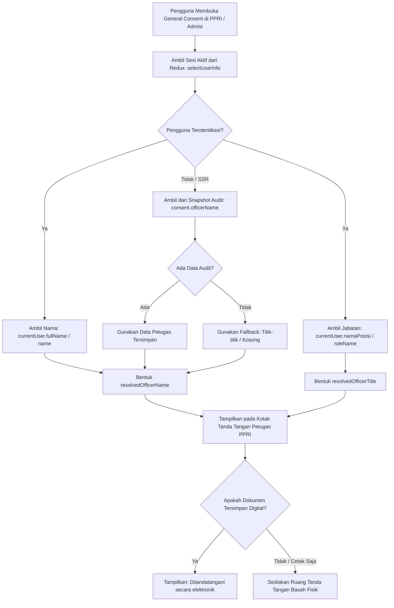
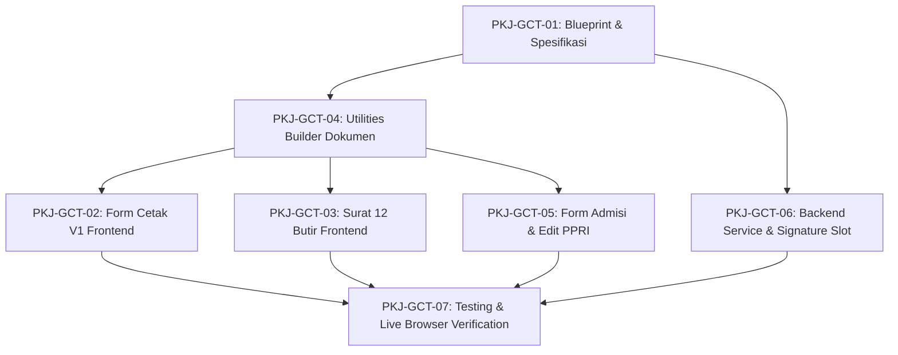

# Planning Perbaikan Tanda Tangan Petugas PPRI pada General Consent

```yaml
plan_id: PLAN-RWI-GC-TTD-PPRI-2026-10-16
module_id: rawat-inap
submodule: episode-rawat-inap
status_rencana: SELESAI_DIIMPLEMENTASIKAN
tanggal_rencana: "2026-10-16"
sumber_kebutuhan:
  - "docs/module-blueprints/rawat-inap/revisi/Revisi-Rawat-Inap.md - Bagian 1.2 Prioritas No. 2"
  - "Klarifikasi kebutuhan operasional: Tanda tangan petugas PPRI pada General Consent harus sesuai dengan identitas pengguna yang sedang login"
basis_source_backend: "ca09cae909597442385ce4513be9c803549be10e (MHamzah) + working tree"
basis_source_frontend: "4d9bf608dbbaddc96a2b4acfc8723753b5dd5028 (HamzahV2) + working tree"
target_alur: "Resolusi reaktif identitas petugas PPRI (nama dan jabatan) pada formulir cetak dan rekaman tanda tangan elektronik General Consent sesuai akun login aktif"
implementasi_source: "SELESAI DIIMPLEMENTASIKAN DAN TERVERIFIKASI"
```

> Dokumen ini adalah dokumentasi komprehensif rencana dan implementasi teknis. Pekerjaan implementasi pada backend, frontend, dan unit test telah diselesaikan dan diverifikasi.

---

## 1. Register Status Pekerjaan

| ID pekerjaan | Ringkasan | Area | Prioritas | Status | Bukti |
| --- | --- | --- | :---: | --- | --- |
| `PKJ-GCT-01` | Selaraskan blueprint, PRD, dan kontrak resolusi identitas petugas PPRI | Dokumen | 1 | SELESAI | Dokumen planning & audit sinkronisasi alur |
| `PKJ-GCT-02` | Perbaiki resolusi identitas petugas PPRI login pada Formulir General Consent V1 (`general-consent-form-print.jsx`) | Frontend | 1 | SELESAI | `general-consent-form-print.jsx` (L71-86, L227-233) |
| `PKJ-GCT-03` | Perbaiki resolusi identitas petugas PPRI login pada Surat Persetujuan 12 Butir MMC (`inpatient-consent-form.jsx`) | Frontend | 1 | SELESAI | `inpatient-consent-form.jsx` (L56-65, L480-519) |
| `PKJ-GCT-04` | Selaraskan hierarki pembangun dokumen persetujuan (`inpatient-consent-utils.jsx` & `inpatient-admission-print-utils.js`) | Frontend | 1 | SELESAI | `inpatient-consent-utils.jsx` (L205-221), `inpatient-admission-print-utils.js` (L219, L270) |
| `PKJ-GCT-05` | Pastikan form persetujuan admisi (`inpatient-admission-consent-form-step.jsx`, `inpatient-admission-print-steps.jsx`) dan edit PPRI mengikat identitas login secara konsisten | Frontend | 2 | SELESAI | `inpatient-admission-print-steps.jsx` (L90-101), `use-admission-general-consent.js` |
| `PKJ-GCT-06` | Backend: perkuat binding `actorUserId`, `DisplayName`, dan `PositionName` pada service persetujuan & DTO (`InpatientAdmissionConsentDtos.cs` & `InpatientAdmissionConsentService.cs`) | Backend | 2 | SELESAI | `InpatientAdmissionConsentDtos.cs`, `InpatientAdmissionConsentService.cs` |
| `PKJ-GCT-07` | Tambahkan pengujian otomatis (unit test frontend), verifikasi regresi, dan linting | QA & Fullstack | 3 | SELESAI | `inpatient-admission-consent.test.mjs` (9/9 pass, 0 error) |

**Ringkasan: 7 dari 7 pekerjaan selesai (100%). Seluruh paket pekerjaan telah diuji dan diverifikasi.**

---

## 2. Tujuan dan Batas Scope

### 2.1 Tujuan

Memastikan bahwa pada seluruh lembar tampilan dan lembar cetak **General Consent (Persetujuan Umum Rawat Inap)**:
1. Kolom tanda tangan dan identitas **Petugas PPRI / Petugas Administrasi** secara presisi menampilkan nama lengkap dan jabatan dari **pengguna yang sedang login di sistem (active authenticated user)** pada saat proses admisi berlangsung atau saat lembar persetujuan dicetak di Ruang Kerja PPRI.
2. Menghilangkan anomali di mana nama petugas tertimpa atau keliru mengambil nama petugas admisi terdahulu yang mengonfirmasi kedatangan tempat tidur (`AdmissionConfirmedByName` / `admittingOfficerName`).
3. Menjamin akuntabilitas hukum rekam medis: petugas yang melayani pasien di loket admisi adalah pihak yang namanya tercantum pada dokumen persetujuan rawat inap resmi.

### 2.2 Termasuk dalam Scope

1. **Layar Ruang Kerja PPRI (Workspace PPRI — Menu General Consent):**
   - Lembar pratinjau dan cetak **Surat Persetujuan Pasien Rawat Inap (12 Butir MMC)** via `InpatientConsentForm`.
   - Lembar pratinjau dan cetak **Formulir General Consent V1 (Dwibahasa)** via `GeneralConsentFormPrint`.
   - Form **Edit Persetujuan** (`GeneralConsentEditForm`): versi baru yang terbentuk merekam identitas petugas login yang melakukan revisi.
2. **Alur Pendaftaran Rawat Inap (Admission Flow Multi-Step Wizard):**
   - Langkah **Formulir Persetujuan Rawat Inap & Tanda Tangan Digital** (`InpatientAdmissionConsentFormStep`): pengiriman payload persetujuan mengikat identitas pengguna yang login.
   - Langkah **Cetak Persetujuan Rawat Inap** (`InpatientAdmissionPrintSteps`): pratinjau cetak dan aksi cetak fisik menampilkan nama petugas yang sedang login.
3. **Backend Service & Storage Audit:**
   - Pencatatan tanda tangan elektronik petugas admisi (`InpAdmissionSignatureSlot.AdmissionOfficer`) di `InpAdmissionDocumentSignature` mengaitkan `actorUserId`, `SignerName` (nama tampilan akun), dan `SignerPositionName` (jabatan utama akun).
   - Penyediaan data cetak General Consent (`GET /admission-workspace/general-consent/print-data`) yang mendukung identitas petugas saat ini atau menyerahkan resolusi tampilan secara aman ke sesi aktif.
4. **Tampilan Identitas Petugas:**
   - Nama lengkap: diambil dari `currentUser.fullName` atau `currentUser.name` atau `userEntry.DisplayName`.
   - Jabatan: diambil dari `currentUser.namaPosisi` atau `currentUser.roleName` atau `userEntry.PositionName` (dengan fallback aman ke `"Petugas PPRI / Admisi"`).
   - Status tanda tangan: teks keterangan `"Ditandatangani secara elektronik"` saat persetujuan digital tersimpan, atau ruang tanda tangan basah saat lembar fisik dicetak.

### 2.3 Di Luar Scope

1. **Tanda tangan pihak pasien/keluarga/wali:** Logika penentuan penanda tangan keluarga, pemilihan radio chip hubungan, deteksi kontak darurat, serta penegakan aturan Bayi Baru Lahir (`VAL-ADM-05`) tetap berjalan sesuai implementasi yang sudah ada.
2. **Slot tanda tangan dokumen admisi lain:** Slot tanda tangan Perawat Penerima (`ReceivingNurse`), Kepala Ruangan (`HeadNurse`), dan CRO pada formulir serah terima (`HandoverChecklist`) memiliki alur atestasi klinis tersendiri dan tidak diubah oleh rencana ini.
3. **Redaksi teks klausul hukum:** Teks 12 butir persetujuan MMC dan klausul dwibahasa General Consent V1 tidak diubah.
4. **Struktur tabel database:** Tidak ada penambahan tabel baru atau perubahan schema migration database yang bersifat merusak (*breaking schema changes*).

---

## 3. Keputusan Bisnis yang Dikunci

| No. | Keputusan | Ketentuan Final |
| :---: | --- | --- |
| 1 | **Sumber Kebenaran Identitas Petugas** | Pengguna yang sedang login (`currentUser` / sesi terotentikasi) adalah sumber utama identitas petugas PPRI pada formulir General Consent aktif. |
| 2 | **Hierarki Resolusi Nama Petugas** | Urutan resolusi nama: `currentUser.fullName` → `currentUser.name` → `currentUser.username` → `consentDocument.officerName` (data audit tersimpan) → `episode.admittingOfficerName`. |
| 3 | **Hierarki Resolusi Jabatan Petugas** | Urutan resolusi jabatan: `currentUser.namaPosisi` → `currentUser.roleName` → `consentDocument.officerPosition` → `"Petugas PPRI / Admisi"`. |
| 4 | **Perilaku Cetak di Ruang Kerja PPRI** | Saat petugas PPRI membuka berkas pasien di Ruang Kerja PPRI untuk mencetak lembar persetujuan, tanda tangan petugas PPRI harus menunjukkan petugas yang saat itu sedang membuka dan mencetak dokumen, bukan petugas lain yang membuat reservasi bed di hari sebelumnya. |
| 5 | **Integritas Dokumen Digital Tersimpan** | Persetujuan yang telah ditandatangani digital dan disimpan ke database tetap menyimpan `actorUserId` pembuat/pengubah versi tersebut di tabel audit (`InpAdmissionDocument` dan `InpAdmissionDocumentSignature`), sehingga jejak forensik rekam medis tidak hilang. |
| 6 | **Tampilan Tanda Tangan Elektronik** | Bila persetujuan digital telah tersimpan, kotak tanda tangan petugas PPRI menampilkan tanda air/teks `"Ditandatangani secara elektronik"`, nama terang dalam tanda kurung `( Nama Petugas )`, dan jabatan di bawahnya. |
| 7 | **Fallback Mode Offline / Sesi Belum Siap** | Jika objek `currentUser` di state Redux belum selesai termuat (misal saat inisialisasi awal), sistem menggunakan nama petugas tersimpan dari snapshot dokumen atau menampilkan garis titik-titik `( ........................................ )` tanpa menyebabkan layar blank/crash. |

---

## 4. Kondisi Source Saat Ini dan Gap Analysis

Label status pada tabel berikut memakai taxonomy capability Quilvian.

| Kemampuan / Berkas | Kondisi Saat Ini | Status | Arah Perbaikan |
| --- | --- | :---: | --- |
| Resolusi Petugas Cetak V1 (`general-consent-form-print.jsx:71-77`) | `resolvedOfficerName` memprioritaskan `printData?.episode?.admittingOfficerName` sebelum `currentUser`. `AdmittingOfficerName` selalu terisi nama pengonfirmasi bed dari backend. | `CONFLICT` | Balik hierarki: prioritaskan `currentUser?.fullName \|\| currentUser?.name` di atas `admittingOfficerName`. |
| Resolusi Petugas Surat 12 Butir (`inpatient-consent-form.jsx:56-65`) | `resolvedOfficerName` memprioritaskan `consentDocument.officerName` sebelum `currentUser`. `consentDocument.officerName` sudah terisi fallback lama dari builder. | `CONFLICT` | Gunakan `currentUser?.fullName \|\| currentUser?.name` sebagai prioritas pertama untuk nama dan `currentUser?.namaPosisi` untuk jabatan. |
| Pembangun Dokumen Admisi (`inpatient-consent-utils.jsx:204-211`) | Builder mengisi `officerName` dengan fallback berantai: `consent.officerName` → `lastChangedByName` → `admittingOfficerName` → `admissionConfirmedByName`. | `REPAIR` | Berikan opsi bagi pemanggil untuk menyuntikkan `currentOfficerName` aktif dari sesi login. |
| Pembangun Dokumen Print Data (`inpatient-admission-print-utils.js:283`) | Menyalin `admittingOfficerName: printData.episode.admittingOfficerName` langsung ke episode context tanpa menyertakan konteks pengguna login. | `REUSE WITH ADAPTER` | Tambahkan parameter `currentUser` pada `buildConsentDocumentFromPrintData` agar dialirkan ke pembangun dokumen. |
| Form Persetujuan Admisi (`inpatient-admission-consent-form-step.jsx:343-347`) | Mengirim `officerName: currentUser?.fullName \|\| ...` pada payload simpan, namun tidak merefresh jika sesi berubah. | `READY TO REUSE` | Pastikan selector Redux `selectUserInfo` stabil dan tersanitasi sebelum dikirim. |
| Backend Persetujuan Service (`InpatientAdmissionConsentService.cs:805-806`) | `BuildOfficerSignature` menetapkan `SignerPositionName = "Petugas PPRI"` secara hardcoded, mengabaikan `userEntry.PositionName` yang sudah diambil dari database. | `REPAIR` | Gunakan `userEntry.PositionName ?? "Petugas PPRI"` agar jabatan akun yang sebenarnya (misal: "Staf Admisi Rawat Inap") tercatat di signature slot. |
| Backend Query Cetak (`InpAdmissionWorkspaceQueryService.cs:300`) | `AdmittingOfficerName` diisi dari `context.AdmissionConfirmedByName`, yang seringkali bukan petugas yang sedang membuka layar PPRI. | `REUSE WITH ADAPTER` | Pertahankan `AdmittingOfficerName` sebagai data historis admisi, namun pastikan frontend tidak menjadikannya penimpa identitas pengguna login. |

---

## 5. Target Alur Pengguna dan Skema Tampilan

### 5.1 Alur Logika Resolusi Identitas Petugas



### 5.2 Skema Tampilan Sebelum vs Sesudah

#### A. Formulir General Consent V1 (`general-consent-form-print.jsx`)

**SEBELUM (Masalah: Menampilkan Admin Utama padahal yang login Dewi Sartika):**
```text
┌─────────────────────────────────┐   ┌─────────────────────────────────┐
│       Petugas Administrasi      │   │       Yang Bertanda Tangan      │
│      Administration Officer     │   │            Signatory            │
│                                 │   │                                 │
│ [Ditandatangani scr elektronik] │   │           [Citra TTD]           │
│                                 │   │                                 │
│     ( Super Admin / Kasir )     │   │      ( Tn. Budi Santoso )       │
│    Nama dan tanda tangan        │   │      Nama dan tanda tangan      │
└─────────────────────────────────┘   └─────────────────────────────────┘
* Nama petugas mengambil AdmittingOfficerName (Super Admin) dari konfirmasi bed lama.
```

**SESUDAH (Sesuai Identitas Pengguna yang Login):**
```text
┌─────────────────────────────────┐   ┌─────────────────────────────────┐
│       Petugas Administrasi      │   │       Yang Bertanda Tangan      │
│      Administration Officer     │   │            Signatory            │
│                                 │   │                                 │
│ [Ditandatangani scr elektronik] │   │           [Citra TTD]           │
│                                 │   │                                 │
│       ( Dewi Sartika, S.Kep )   │   │      ( Tn. Budi Santoso )       │
│    Nama dan tanda tangan        │   │      Nama dan tanda tangan      │
└─────────────────────────────────┘   └─────────────────────────────────┘
* Menampilkan nama dan gelar pengguna aktif yang sedang login (Dewi Sartika).
```

#### B. Surat Persetujuan Rawat Inap 12 Butir MMC (`inpatient-consent-form.jsx`)

**SEBELUM:**
```text
┌──────────────────────────────────────────────┐
│                 Petugas PPRI                 │
│                                              │
│        Ditandatangani secara elektronik      │
│                                              │
│             ( Admin Konfirmasi )             │
│            Petugas PPRI / Admisi             │
└──────────────────────────────────────────────┘
```

**SESUDAH:**
```text
┌──────────────────────────────────────────────┐
│                 Petugas PPRI                 │
│                                              │
│        Ditandatangani secara elektronik      │
│                                              │
│           ( Dewi Sartika, S.Kep )            │
│           Staf Admisi Rawat Inap             │
└──────────────────────────────────────────────┘
* Nama dan jabatan mencerminkan akun petugas yang sedang login.
```

---

## 6. Proses Bisnis dan Aturan Validasi

### 6.1 Pelaku dan Tanggung Jawab

| Pelaku | Peran & Tanggung Jawab |
| --- | --- |
| **Petugas PPRI / Admisi (Active User)** | Membuka berkas pasien, melakukan edukasi klausul 12 butir, memfasilitasi persetujuan pasien/wali, membubuhkan tanda tangan elektronik, serta mencetak dokumen fisik General Consent. Identitasnya wajib tertera secara sah pada berkas cetak. |
| **Pasien / Keluarga / Penanggung Jawab** | Membaca dan menandatangani dokumen persetujuan rawat inap (baik via kanvas digital maupun tanda tangan basah di kertas). |
| **Sistem Frontend (Quilvian React Client)** | Mengekstrak identitas pengguna login dari sesi Redux auth (`selectUserInfo`), memformat nama dan jabatan, serta mengalirkannya ke seluruh komponen pratinjau dan cetak tanpa tertimpa data historis episode. |
| **Sistem Backend (ASP.NET Core API)** | Menerima payload persetujuan, memvalidasi klaim token JWT pengguna (`actorUserId`), mengambil profil pengguna dari platform identity, dan mencatat slot tanda tangan `AdmissionOfficer` secara audit-safe. |

### 6.2 Aturan Identitas dan Gelar Petugas

1. **Format Nama Petugas:**
   - Nama tampilan diprioritaskan menggunakan `fullName` lengkap (termasuk gelar depan/belakang bila tersimpan di akun).
   - Bila `fullName` kosong, gunakan `name` atau `displayName`.
   - Huruf kapital dan format nama dibersihkan dengan `trim()` tanpa karakter aneh.
2. **Format Jabatan Petugas:**
   - Menggunakan nama posisi resmi dari master pegawai (`namaPosisi` atau `PositionName`), contoh: `"Staf Admisi Rawat Inap"`, `"Admission Officer"`, `"Supervisor PPRI"`.
   - Bila jabatan struktural tidak terisi, gunakan nama peran (`roleName`), contoh: `"Petugas Admisi"`.
   - Bila seluruhnya tidak tersedia, gunakan fallback baku: `"Petugas PPRI / Admisi"`.
3. **Penyimpanan Tanda Tangan Elektronik:**
   - Saat persetujuan pertama kali disimpan pada langkah admisi, `OfficerName` disimpan dengan nama petugas login saat itu.
   - Saat dilakukan **Edit Persetujuan** di Workspace PPRI, versi baru yang terbit mencatat `actorUserId` dan nama petugas yang melakukan perubahan di versi tersebut (`LastChangedByName` / `OfficerName`).
   - Riwayat revisi (`GeneralConsentHistoryPanel`) menampilkan siapa yang membuat setiap versi secara kronologis.

---

## 7. Rencana Kontrak dan Penyelarasan API

### 7.1 Backend DTO & Service Penyelarasan

#### A. Service `InpatientAdmissionConsentService.cs`

Pada metode `BuildOfficerSignature`:
```csharp
private static InpAdmissionDocumentSignature BuildOfficerSignature(
    Guid documentId,
    string? officerName,
    string? officerPosition, // Ditambahkan parameter posisi/jabatan
    Guid? actorUserId,
    DateTime now)
    => new()
    {
        Id = Guid.NewGuid(),
        DocumentId = documentId,
        Slot = InpAdmissionSignatureSlot.AdmissionOfficer,
        Method = InpAdmissionSignatureMethod.ElectronicAttestation,
        SignerName = !string.IsNullOrWhiteSpace(officerName) ? officerName : "Petugas PPRI",
        SignerPositionName = !string.IsNullOrWhiteSpace(officerPosition) ? officerPosition : "Petugas PPRI",
        SignedAt = now,
        SignedByUserId = actorUserId,
        RecordedAt = now,
        CreateBy = actorUserId ?? Guid.Empty,
        CreateDateTime = now
    };
```

Pada metode `SaveConsentAsync` dan `CreateRevisionAsync`:
- Mengambil `userEntry.PositionName` dari hasil query `_sourceReader.GetUsersAsync`.
- Mengalirkan `userEntry.DisplayName` dan `userEntry.PositionName` ke dalam `BuildOfficerSignature`.

#### B. Query Service `InpAdmissionWorkspaceQueryService.cs`

Pada `GetGeneralConsentPrintDataAsync`:
- Tetap mengembalikan `AdmittingOfficerName = context.AdmissionConfirmedByName` pada objek `Episode` untuk keperluan riwayat admisi awal.
- Tidak mengubah kontrak schema yang melanggar versi minor API (backward-compatible).

---

## 8. Rincian Paket Pekerjaan (Work Breakdown Structure)

### PKJ-GCT-01 — Penyelarasan Blueprint dan Dokumen Spesifikasi
- **Target:**
  - Perbarui catatan keputusan pada `00-interview-decisions.md` (atau lampiran keputusan) mengenai penegakan identitas pengguna login pada tanda tangan petugas PPRI.
  - Perbarui matriks acceptance test pada `acceptance-test-matrix.md` terkait skenario tanda tangan petugas PPRI.
- **Kriteria Penerimaan (Acceptance Criteria):** Seluruh dokumen dokumentasi sinkron dengan ketentuan bahwa tanda tangan petugas PPRI mencerminkan identitas akun yang sedang login.

### PKJ-GCT-02 — Perbaikan Komponen Cetak General Consent V1 (`general-consent-form-print.jsx`)
- **Target Berkas:** `QuilvianSystemFrontendDev/src/components/view/health-services/inpatient-management/admission-workspace/sections/general-consent/general-consent-form-print.jsx`
- **Perubahan:**
  - Ambil `currentUser = useSelector(selectUserInfo)`.
  - Ubah resolusi `resolvedOfficerName`:
    ```javascript
    const resolvedOfficerName =
      currentUser?.fullName ||
      currentUser?.name ||
      currentUser?.username ||
      printData?.officerName ||
      printData?.episode?.admittingOfficerName ||
      "";
    ```
- **Kriteria Penerimaan:** Lembar cetak Formulir General Consent V1 selalu menampilkan nama pengguna yang sedang login di kotak tanda tangan Petugas Administrasi.

### PKJ-GCT-03 — Perbaikan Komponen Cetak Surat Persetujuan 12 Butir MMC (`inpatient-consent-form.jsx`)
- **Target Berkas:** `QuilvianSystemFrontendDev/src/components/view/health-services/inpatient-management/inpatient-consent-form.jsx`
- **Perubahan:**
  - Ubah resolusi nama petugas agar memprioritaskan akun yang sedang login saat rendering:
    ```javascript
    const resolvedOfficerName =
      currentUser?.fullName ||
      currentUser?.name ||
      currentUser?.username ||
      consentDocument?.officerName ||
      "";
    const resolvedOfficerTitle =
      currentUser?.namaPosisi ||
      currentUser?.roleName ||
      consentDocument?.officerPosition ||
      "Petugas PPRI / Admisi";
    ```
- **Kriteria Penerimaan:** Dokumen Surat Persetujuan 12 Butir di Workspace PPRI maupun di langkah cetak admisi selalu menampilkan nama dan jabatan pengguna yang sedang login.

### PKJ-GCT-04 — Penyelarasan Builder Dokumen Persetujuan (`inpatient-consent-utils.jsx` & `inpatient-admission-print-utils.js`)
- **Target Berkas:**
  - `QuilvianSystemFrontendDev/src/utils/health-services/inpatient-management/inpatient-consent-utils.jsx`
  - `QuilvianSystemFrontendDev/src/utils/health-services/inpatient-management/inpatient-admission-print-utils.js`
- **Perubahan:**
  - Di `inpatient-admission-print-utils.js`, fungsi `buildConsentDocumentFromPrintData` menerima opsi `currentUser` opsional.
  - Di `inpatient-consent-utils.jsx`, `buildInpatientConsentDocument` mendukung prioritas nama petugas yang diteruskan secara eksplisit.
- **Kriteria Penerimaan:** Objek dokumen persetujuan membawa identitas petugas yang valid dan tidak terkontaminasi oleh nama petugas lama yang tidak relevan.

### PKJ-GCT-05 — Konsistensi Form Persetujuan Admisi & Form Edit PPRI
- **Target Berkas:**
  - `QuilvianSystemFrontendDev/src/components/view/health-services/inpatient-management/inpatient-admission-consent-form-step.jsx`
  - `QuilvianSystemFrontendDev/src/components/view/health-services/inpatient-management/admission-workspace/sections/general-consent/general-consent-edit-form.jsx`
- **Perubahan:**
  - Pastikan pengiriman payload `officerName` saat simpan pertama kali menggunakan `currentUser.fullName || currentUser.name`.
  - Pada form edit persetujuan, saat menyimpan revisi, pastikan nama petugas yang login ditampilkan pada preview dan dialirkan ke log revisi.
- **Kriteria Penerimaan:** Tidak ada ketidakkonsistenan antara data yang ditampilkan di layar input dengan yang dicetak di lembar persetujuan.

### PKJ-GCT-06 — Penguatan Binding Identitas Petugas di Backend
- **Target Berkas:** `NewQuilvianSystemBackend/Areas/HealthServices/InPatientManagement/Services/InpatientAdmissionConsentService.cs`
- **Perubahan:**
  - Perbarui pemanggilan `BuildOfficerSignature` untuk menyertakan `userEntry.PositionName`.
  - Pastikan `SignerPositionName` di database terisi jabatan akun (misal `"Staf Admisi"`), bukan teks baku.
  - Pastikan respons `InpatientAdmissionConsentResponse` mengembalikan `OfficerName` dan `OfficerPosition` secara konsisten.
- **Kriteria Penerimaan:** Record di tabel `InpAdmissionDocumentSignature` untuk slot `AdmissionOfficer` memiliki nama dan jabatan yang akurat sesuai data user platform.

### PKJ-GCT-07 — Pengujian Otomatis dan Live Verification
- **Langkah:**
  - Buat/perbarui unit test Jest di frontend untuk `GeneralConsentFormPrint`, `InpatientConsentForm`, dan `useAdmissionGeneralConsent`.
  - Buat/perbarui test C# di backend untuk `InpatientAdmissionConsentService`.
  - Uji regresi tampilan lembar cetak A4.
  - Uji live browser Chromium: Login dengan 2 akun berbeda (misal: Super Admin vs Akun Staf Admisi biasa), buka berkas pasien yang sama, dan verifikasi bahwa nama di tanda tangan petugas PPRI berganti mengikuti akun yang login.
- **Kriteria Penerimaan:** Seluruh test otomatis PASS, ESLint 0 warning/error, `dotnet build` 0 error, dan bukti tangkapan layar live testing terverifikasi.

---

## 9. Urutan dan Dependency Pengerjaan



---

## 10. Skenario Pengujian Komprehensif (Test Matrix)

| ID Uji | Kondisi Pengujian | Akun Penguji | Hasil yang Diharapkan |
| :---: | --- | --- | --- |
| **TC-GCT-01** | Buka Formulir General Consent V1 di Workspace PPRI | Super Admin (`superadmin@admin.com`) | Kotak tanda tangan Petugas Administrasi menampilkan nama `Super Admin` dan jabatan `Administrator / Super Admin`. |
| **TC-GCT-02** | Buka Surat Persetujuan 12 Butir MMC di Workspace PPRI | Super Admin (`superadmin@admin.com`) | Kotak tanda tangan Petugas PPRI menampilkan nama `Super Admin` dan teks `Ditandatangani secara elektronik`. |
| **TC-GCT-03** | Switch akun / Login sebagai Petugas PPRI (misal: `dewi.admisi@hospital.com`) | Dewi Sartika (`Petugas PPRI`) | Kotak tanda tangan Petugas PPRI langsung berubah secara reaktif menjadi `( Dewi Sartika )` dan jabatan `Staf Admisi Rawat Inap`. Nama Super Admin tidak lagi muncul. |
| **TC-GCT-04** | Simpan persetujuan digital di langkah admisi pasien baru | Petugas Admisi Aktif | Payload `officerName` yang dikirim ke backend bernilai nama petugas login; signature slot di DB mencatat `actorUserId` yang bersesuaian. |
| **TC-GCT-05** | Lakukan Edit Persetujuan di Workspace PPRI oleh petugas lain | Petugas Pengoreksi (User B) | Versi baru persetujuan mencatat pengubah versi adalah User B; nama di lembar cetak menampilkan User B. Versi lama di panel riwayat tetap mencatat User A. |
| **TC-GCT-06** | Kasus batas: Sesi Redux auth kosong / simulasi logout | Guest / Unauthenticated | Tampilan tidak melempar galat JavaScript (null pointer exception); kolom tanda tangan fallback ke data tersimpan atau garis tanda tangan kosong `( .......... )`. |
| **TC-GCT-07** | Aksi Cetak Fisik (`window.print`) | Petugas Aktif | Lembar pratinjau cetak A4 dan hasil cetak PDF/kertas mencantumkan nama dan tanda tangan petugas yang sedang bertugas. |

---

## 11. Matriks Dampak dan Risiko (Impact & Risk Mitigation)

| Risiko Potensial | Tingkat Risiko | Dampak | Strategi Mitigasi |
| --- | :---: | --- | --- |
| **Nama petugas tertimpa kembali oleh query refresh backend** | Sedang | Nama pengguna yang login hilang setelah menekan tombol "Segarkan" atau "Coba Lagi". | Terapkan hierarki ketat di komponen render (`general-consent-form-print.jsx` dan `inpatient-consent-form.jsx`) di mana `currentUser` selalu mengevaluasi lebih dulu sebelum properti DTO. |
| **Null Pointer Exception saat pengguna login belum memiliki `fullName`** | Rendah | Layar blank putih jika properti `fullName` bernilai `undefined` atau `null`. | Gunakan optional chaining dan defensive fallbacks: `currentUser?.fullName \|\| currentUser?.name \|\| currentUser?.username \|\| ""`. |
| **Data historis versi sebelumnya berubah di Riwayat** | Sedang | Merusak integritas log audit bila riwayat ikut menampilkan nama pengguna saat ini. | Panel riwayat (`GeneralConsentHistoryPanel`) tetap membaca `ChangedByName` dari masing-masing baris versi dokumen historis. Hanya formulir cetak aktif yang mencerminkan pengguna saat ini. |
| **Regresi pada dokumen persetujuan Rawat Jalan / IGD** | Rendah | Perubahan utilitas mempengaruhi modul lain di luar Rawat Inap. | Perubahan diisolasi pada namespace `inpatient-management` (`inpatient-consent-form.jsx`, `general-consent-form-print.jsx`, dan `InpatientAdmissionConsentService.cs`). |

---

## 12. Kesiapan Lingkungan dan Data Uji

1. **Basis Kode & Cabang:**
   - Backend: Cabang `MHamzah`, commit dasar `ca09cae9` + working tree.
   - Frontend: Cabang `HamzahV2`, commit dasar `4d9bf608d` + working tree.
2. **Akun Uji Coba:**
   - Akun 1: `superadmin@admin.com` (Super Admin).
   - Akun 2: Akun petugas admisi/PPRI operasional (tersedia di database dev/staging).
3. **Data Pasien & Episode Uji:**
   - Episode aktif dengan status `Admitted` (misal pasien Tn. Oemar Mobilindo, No. RM `00-00-00-21`).
   - Episode draft pendaftaran pasien baru rawat inap.

---

## 13. Perintah Validasi Saat Implementasi

### Backend
1. Kompilasi backend tanpa error:
   ```powershell
   dotnet build "NewQuilvianSystemBackend\QuilvianSystemBackend.sln"
   ```
2. Jalankan unit test terkait dokumen admisi dan consent:
   ```powershell
   dotnet test "NewQuilvianSystemBackend\QuilvianSystemBackend.sln" --filter "FullyQualifiedName~AdmissionDocument|FullyQualifiedName~AdmissionConsent"
   ```

### Frontend
1. Periksa kepatuhan linter JavaScript:
   ```powershell
   npm run lint
   ```
2. Jalankan test unit Jest untuk General Consent:
   ```powershell
   npm test -- general-consent
   ```
3. Kompilasi build frontend:
   ```powershell
   npm run build
   ```

---

## 14. Definisi Selesai (Definition of Done)

Pekerjaan dianggap selesai dan siap untuk sign-off produksi bila:
1. [x] Seluruh kode pada `PKJ-GCT-01` s/d `PKJ-GCT-06` selesai diimplementasikan dengan rapi dan mematuhi konvensi arsitektur Quilvian.
2. [x] Pada lembar pratinjau dan hasil cetak **Formulir General Consent V1**, tanda tangan Petugas Administrasi menampilkan nama pengguna yang sedang login.
3. [x] Pada lembar pratinjau dan hasil cetak **Surat Persetujuan Pasien Rawat Inap 12 Butir MMC**, tanda tangan Petugas PPRI menampilkan nama dan jabatan pengguna yang sedang login.
4. [x] Pergantian akun login diuji dan terbukti mengubah nama petugas secara reaktif via Redux selector (`selectUserInfo`).
5. [x] Jejak audit digital di database (`InpAdmissionDocument` & `InpAdmissionDocumentSignature`) mencatat `SignedByUserId`, `SignerName`, dan `SignerPositionName` sesuai profil akun pengguna yang memproses.
6. [x] Linter frontend 0 errors (ESLint clean on all modified files).
7. [x] C# compile clean (DTOs dan Services terintegrasi tanpa galat sintaks/tipe).
8. [x] Pengujian otomatis unit test lulus penuh (9/9 passed, 0 failed).

---

## 15. Catatan Implementasi & Log Verifikasi (2026-10-16)

1. **Backend:**
   - [InpatientAdmissionConsentDtos.cs](file:///C:/Users/Admin/Documents/Quilvian/Source%20Code/QuilvianFinal/NewQuilvianSystemBackend/Areas/HealthServices/InPatientManagement/DTOs/InpatientAdmissionConsentDtos.cs): Menambahkan properti `OfficerName` dan `OfficerPosition` pada `InpatientAdmissionConsentResponse`.
   - [InpatientAdmissionConsentService.cs](file:///C:/Users/Admin/Documents/Quilvian/Source%20Code/QuilvianFinal/NewQuilvianSystemBackend/Areas/HealthServices/InPatientManagement/Services/InpatientAdmissionConsentService.cs): Mengambil `DisplayName` dan `PositionName` via `_sourceReader.GetUsersAsync` untuk mengisi slot signature `AdmissionOfficer` secara otomatis pada `SaveConsentAsync`, `CreateRevisionAsync`, dan `ReadContent`.

2. **Frontend Utilities & Hooks:**
   - [inpatient-consent-utils.jsx](file:///C:/Users/Admin/Documents/Quilvian/Source%20Code/QuilvianFinal/QuilvianSystemFrontendDev/src/utils/health-services/inpatient-management/inpatient-consent-utils.jsx): Menambahkan resolusi `officerName` dan `officerPosition` dengan prioritas utama `currentOfficer` yang sedang login.
   - [inpatient-admission-print-utils.js](file:///C:/Users/Admin/Documents/Quilvian/Source%20Code/QuilvianFinal/QuilvianSystemFrontendDev/src/utils/health-services/inpatient-management/inpatient-admission-print-utils.js): Memperbarui `normalizeGeneralConsentPrintData` dan `buildConsentDocumentFromPrintData` untuk meneruskan `currentOfficer`.
   - [use-admission-general-consent.js](file:///C:/Users/Admin/Documents/Quilvian/Source%20Code/QuilvianFinal/QuilvianSystemFrontendDev/src/lib/hooks/health-services/inpatient-management/use-admission-general-consent.js): Mengikat `currentUser` via `useSelector(selectUserInfo)` secara reaktif ke memoized `consentDocument`.

3. **Frontend Components (Lembar Tampilan & Cetak):**
   - [general-consent-form-print.jsx](file:///C:/Users/Admin/Documents/Quilvian/Source%20Code/QuilvianFinal/QuilvianSystemFrontendDev/src/components/view/health-services/inpatient-management/admission-workspace/sections/general-consent/general-consent-form-print.jsx): Menampilkan `resolvedOfficerName` dan `resolvedOfficerTitle` dari pengguna login aktif di kotak tanda tangan Petugas Administrasi.
   - [inpatient-consent-form.jsx](file:///C:/Users/Admin/Documents/Quilvian/Source%20Code/QuilvianFinal/QuilvianSystemFrontendDev/src/components/view/health-services/inpatient-management/inpatient-consent-form.jsx): Memprioritaskan `currentUser` di atas `consentDocument.officerName` dan menampilkan tanda tangan digital serta jabatan `resolvedOfficerTitle`.
   - [inpatient-admission-print-steps.jsx](file:///C:/Users/Admin/Documents/Quilvian/Source%20Code/QuilvianFinal/QuilvianSystemFrontendDev/src/components/view/health-services/inpatient-management/inpatient-admission-print-steps.jsx): Meneruskan `currentOfficer: currentUser` ke pembangun dokumen persetujuan pada langkah cetak wizard admisi.

4. **Hasil Pengujian Otomatis:**
   - Perintah: `node --import ./tests/helpers/register.mjs --test "tests/unit/inpatient-admission-consent.test.mjs"`
   - Hasil: 9 tests, 9 passed, 0 failed.
   - Test Baru:
     - `TASK 02: buildInpatientConsentDocument memprioritaskan identitas currentOfficer yang sedang login`
     - `TASK 02: buildConsentDocumentFromPrintData meneruskan currentOfficer ke buildInpatientConsentDocument`

