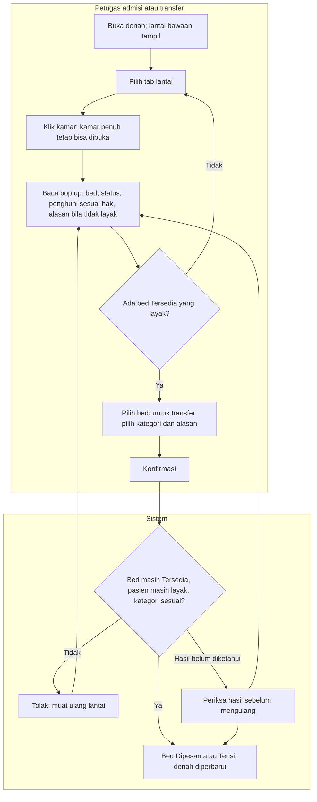

# FLOW-DNH-MVP-001 — Memilih bed lewat denah (admisi dan transfer)

**approved** Muhammad Hamzah, 2026-10-16 (`RWI-DEC-324`), ditulis 15 Oktober 2026; mengikuti [manifest](../blueprint-manifest.md), last_changed_in 0.13.0. Owner produk/domain Muhammad Hamzah.

Pelaku dan pemicu: petugas admisi pada langkah Pilih Bed (termasuk admisi bayi), atau petugas transfer saat memilih tujuan. Prasyarat: episode Draft untuk admisi, atau pasien dengan hunian aktif untuk transfer. Trace: DEC-299/303/315/316/312; AC-436/442/452/453/450.

| Langkah | Pelaku | Masukan | Keluaran | Bila gagal |
| --- | --- | --- | --- | --- |
| Buka denah dan pilih lantai | Petugas | Episode dari langkah sebelumnya | Peta lantai dengan badge dan outline hijau pada kamar yang bisa dipilih pasien itu | Muat ulang; bila lantai tanpa kamar, pilih lantai lain |
| Buka kamar | Petugas | Kamar di peta | Pop up berisi setiap bed dan penghuninya sesuai hak | Kamar Penuh tetap dibuka untuk melihat penghuni |
| Pilih bed | Petugas | Bed Tersedia yang layak; kategori dan alasan untuk transfer | Konfirmasi siap dikirim | Bed tidak layak menampilkan alasannya; pilih bed lain |
| Simpan | Sistem | Versi bed terbaru, kelayakan, kategori | Bed Dipesan (admisi) atau Terisi dan asal Menunggu Pembersihan (transfer) | Bed sudah diambil orang lain: muat ulang dan pilih lagi |
| Hasil belum diketahui | Petugas/sistem | Koneksi terputus sesudah konfirmasi | Hasil diperiksa lebih dulu | Jangan mengulang dengan permintaan baru; ikuti alur 14 |

Jenis kelamin tidak diperiksa maupun ditampilkan pada alur ini. High/Low Dependency hanya ditampilkan dan tidak membatasi pilihan. Transfer yang melibatkan kelas khusus (ICU, ODC, Isolasi, Perinatologi) menerima kategori apa pun.

Kontrak authoritative: [state](../contracts/state-transition-matrix.md), [API](../contracts/api-contract.md), [validasi](../contracts/validation-matrix.md), [acceptance](../testing/acceptance-test-matrix.md).
