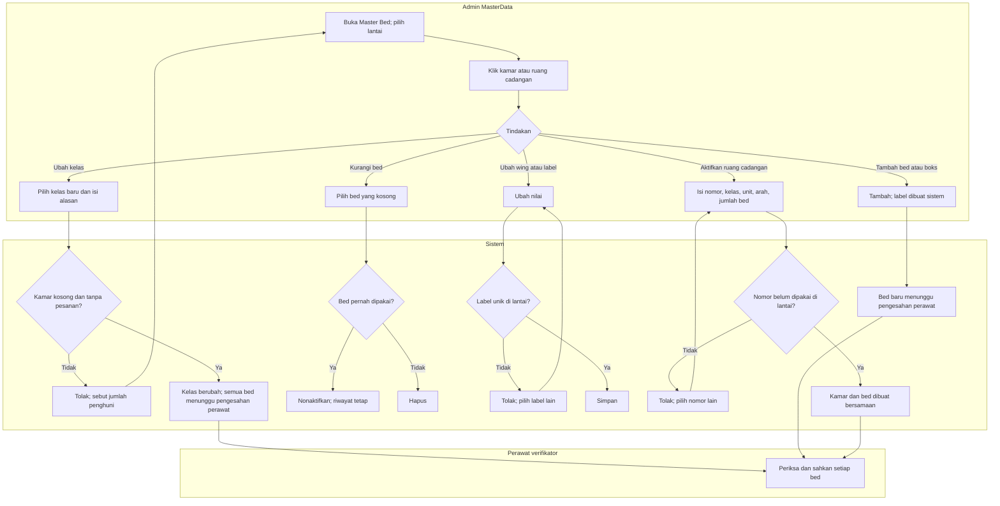

# FLOW-DNH-MVP-002 — Mengelola kamar dan bed lewat denah

**approved** Muhammad Hamzah, 2026-10-16 (`RWI-DEC-324`), ditulis 15 Oktober 2026; mengikuti [manifest](../blueprint-manifest.md), last_changed_in 0.13.0. Owner produk/domain Muhammad Hamzah; MasterData seluruh tim.

Pelaku dan pemicu: admin MasterData saat kamar berubah kelas, bed bertambah atau berkurang, bed rusak, arah wing perlu dikoreksi, atau ruang cadangan dipakai. Prasyarat: susunan denah sudah diimpor. Trace: DEC-304/313/317/318/306; AC-444/451/454–457.

| Langkah | Pelaku | Masukan | Keluaran | Bila gagal |
| --- | --- | --- | --- | --- |
| Ubah kelas | Admin/sistem | Kelas baru, alasan, kamar kosong | Nama kamar dan penanda turunan berubah; bed Tidak Tersedia sampai disahkan | Kamar masih dihuni: tunggu kosong |
| Tambah bed atau boks | Admin/sistem | Kamar; jenis bed | Bed berlabel huruf berikutnya, kode sistem otomatis; badge bertambah | Simpan gagal: tidak ada bed setengah jadi |
| Kurangi bed | Admin/sistem | Bed kosong | Dihapus bila belum pernah dipakai, nonaktif bila punya riwayat | Bed masih Terisi atau Dipesan: tunggu kosong |
| Ubah wing atau label | Admin/sistem | Arah baru atau label baru | Lokasi atau label berubah tanpa menyentuh penghuni | Label sudah dipakai di lantai: pilih lain |
| Aktifkan ruang cadangan | Admin/sistem | Nomor, kelas, unit, arah, jumlah bed | Kamar baru beserta bed muncul di semua denah | Nomor sudah dipakai: pilih lain; tidak ada kamar tanpa bed |
| Sahkan bed | Perawat verifikator | Pemeriksaan fisik | Bed Tersedia | Belum siap: catat alasan; ikuti alur 11 |

Kode bed dan kode kamar tetap kode sistem; petugas membaca label dan nama kamar. Kapasitas pada badge dihitung dari bed aktif, sehingga menambah bed tidak menunggu kamar kosong.

Kontrak authoritative: [state](../contracts/state-transition-matrix.md), [API](../contracts/api-contract.md), [validasi](../contracts/validation-matrix.md), [acceptance](../testing/acceptance-test-matrix.md).
