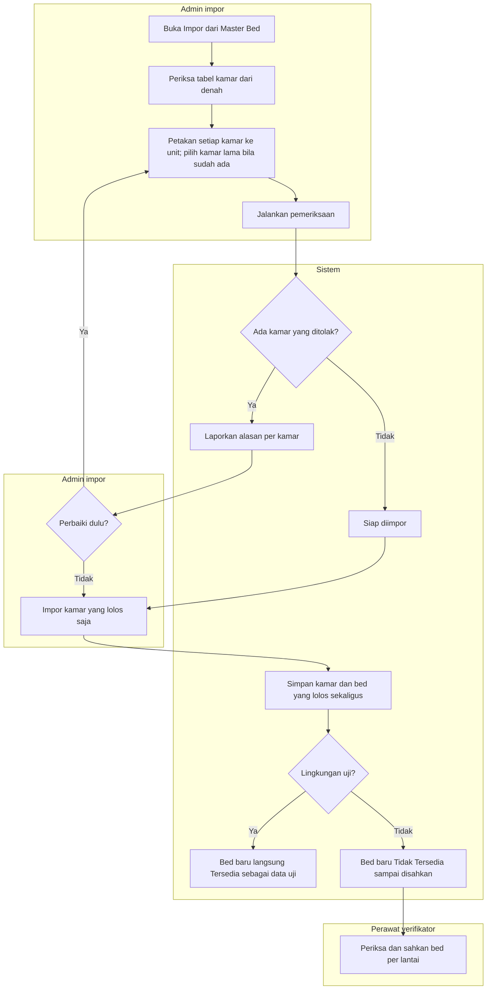

# FLOW-DNH-MVP-003 — Impor susunan denah dan kesiapan awal

**approved** Muhammad Hamzah, 2026-10-16 (`RWI-DEC-324`), ditulis 15 Oktober 2026; mengikuti [manifest](../blueprint-manifest.md), last_changed_in 0.13.0. Owner produk/domain Muhammad Hamzah; penanggung jawab keperawatan untuk pengesahan produksi.

Pelaku dan pemicu: admin impor berwenang. Dev/UAT: sesudah data rawat inap DB Hamzah dibersihkan. Produksi: sekali, sesudah RS mengesahkan susunan kamar. Prasyarat: kelas resmi sudah diterapkan bersama konfigurasi urutan kelas; unit rawat inap tersedia. Trace: DEC-306/321/322/323; AC-446/459–461.

| Langkah | Pelaku | Masukan | Keluaran | Bila gagal |
| --- | --- | --- | --- | --- |
| Siapkan tabel | Admin | Data denah frontend: lantai, nomor, kelas, jumlah bed dan boks, arah | Tabel kamar lengkap | Kelas belum ada di master: terapkan kelas resmi dulu |
| Petakan unit | Admin | Unit rawat inap yang diakui RS | Setiap kamar punya unit; kamar lama dipilih bila sudah ada | Kamar tanpa unit ditolak |
| Periksa | Sistem | Tabel kamar | Ringkasan dibuat/diperbarui/tanpa perubahan/ditolak beserta alasan | Perbaiki pemetaan atau lanjutkan tanpa kamar yang ditolak |
| Impor | Sistem | Kamar yang lolos | Kamar dan bed tersimpan bersamaan; catatan impor | Simpan gagal: tidak ada yang tersimpan; ulangi |
| Ulang impor | Admin | Tabel yang sama | Tidak ada kamar maupun bed baru | Kamar lama yang berbeda dari denah hanya dilaporkan |
| Sahkan bed (produksi) | Perawat verifikator | Pemeriksaan fisik per bed | Bed Tersedia | Belum siap: catat alasan; ikuti alur 11 |

Importer tidak pernah menghapus kamar, tidak mengubah kelas, unit, maupun bed kamar yang sudah ada, dan tidak membuat unit baru. Di produksi, bed hasil impor tidak dapat langsung Tersedia.

Kontrak authoritative: [state](../contracts/state-transition-matrix.md), [API](../contracts/api-contract.md), [validasi](../contracts/validation-matrix.md), [acceptance](../testing/acceptance-test-matrix.md).
