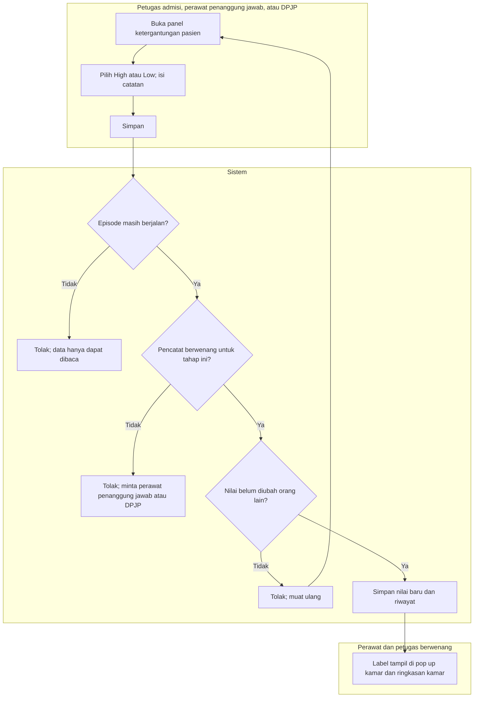

# FLOW-DNH-MVP-004 — Mencatat tingkat ketergantungan pasien

**approved** Muhammad Hamzah, 2026-10-16 (`RWI-DEC-324`), ditulis 15 Oktober 2026; mengikuti [manifest](../blueprint-manifest.md), last_changed_in 0.13.0. Owner produk/domain Muhammad Hamzah; kriteria klinis milik SOP keperawatan RS (RWI-OQ-141).

Pelaku dan pemicu: petugas admisi (catatan awal), perawat penanggung jawab (penilaian), atau DPJP (keputusan) saat kebutuhan observasi pasien berubah. Trace: DEC-302/303; AC-440/441/443.

| Langkah | Pelaku | Masukan | Keluaran | Bila gagal |
| --- | --- | --- | --- | --- |
| Catatan awal | Petugas admisi | Keterangan dokter pengirim; episode Draft | Nilai awal dengan sumber catatan admisi | Episode bukan Draft: serahkan ke perawat penanggung jawab |
| Penilaian | Perawat penanggung jawab | Hasil observasi menurut SOP | Nilai baru dengan sumber penilaian perawat | Bukan perawat penanggung jawab aktif: minta yang ditugaskan |
| Keputusan | DPJP | Keputusan klinis | Nilai baru dengan sumber keputusan DPJP | Bukan DPJP aktif: minta DPJP |
| Simpan | Sistem | Nilai, catatan, nilai yang dilihat pencatat | Episode dan satu baris riwayat | Sudah diubah orang lain: muat ulang lalu nilai kembali |
| Baca | Petugas berwenang | Denah atau detail episode | Label per bed dan ringkasan kamar | Housekeeping tidak melihat label ini |

Nilai ini tidak membatasi penempatan dan tidak memengaruhi biaya. Riwayat tidak ditimpa; nilai tidak dapat dikembalikan menjadi "belum dinilai".

Kontrak authoritative: [state](../contracts/state-transition-matrix.md), [API](../contracts/api-contract.md), [permission](../contracts/permission-audit-matrix.md), [acceptance](../testing/acceptance-test-matrix.md).
