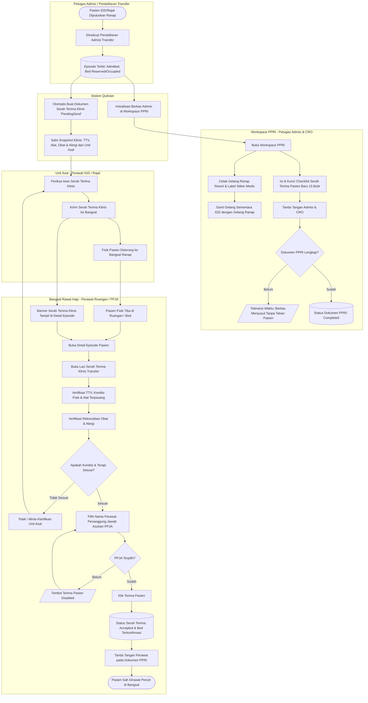

# Flowchart — Alur Pasien Transfer Masuk (IGD/Rajal ke Rawat Inap) Setelah Pendaftaran Admisi

| Field | Nilai |
|---|---|
| Sub-modul | `episode-rawat-inap` (kolaborasi dengan `ClinicalManagement` dan `Workspace PPRI`) |
| Kontrak | `0.14.0` — `draft` |
| Proses | `BP-RWI-TRF-01` |
| Dokumen Acuan | `00-interview-decisions.md` (Wawancara Transfer Pasien Masuk), `admission-transfer-repair-006.md` |

---

## 1. Narasi Alur Bisnis Terpadu

Alur transfer pasien masuk dimulai setelah proses pendaftaran admisi transfer (baik dari Instalasi Gawat Darurat/IGD maupun Poliklinik Rawat Jalan/Rajal) disetujui dan dieksekusi oleh Petugas Admisi melalui tombol submit admisi transfer (`POST /admission-transfers/admit`). 

Alur ini memisahkan dua tanggung jawab utama secara paralel dan tidak saling menghalangi (*non-blocking*):
1. **Jalur Administrasi & Berkas di Workspace PPRI**: Petugas Admisi memverifikasi kelengkapan berkas, mencetak Gelang Rawat Inap resmi beserta label stiker medis, serta memproses checklist Formulir Serah Terima Pasien Baru (tanda tangan Admisi, CRO, dan Perawat).
2. **Jalur Pasien Fisik & Klinis di Detail Episode Bangsal**: Pasien fisik beserta perawat pengantar dapat langsung didorong ke bangsal rawat inap tanpa menunggu dokumen PPRI selesai 100%. Di bangsal rawat inap, Perawat Bangsal membuka **Detail Episode Rawat Inap**, melihat banner serah terima aktif, membuka laci serah terima klinis (`TransferHandoverDrawer`), memverifikasi TTV, kondisi fisik, alat medis terpasang, merekonsiliasi obat & alergi, serta **wajib menetapkan Perawat Penanggung Jawab Asuhan (PPJA)** sebelum menekan tombol `[Terima Pasien]`.

---

## 2. Diagram Alur Terpadu (Mermaid Flowchart)

---

## 3. Matriks Langkah Alur Proses Bisnis

| No | Langkah | Pelaku | Masukan (Input) | Keluaran (Output) | Penanganan Bila Gagal / Deviasi |
|---|---|---|---|---|---|
| 1 | **Eksekusi Admisi Transfer** | Petugas Admisi | Disposisi transfer IGD atau Rujukan Poli, pilihan bed, DPJP, penjamin | Episode Rawat Inap (`InpEpisode`) berstatus `Admitted`, bed terpesan | Jika bed terkunci/bentrok: sistem menolak dengan pesan validasi kelas/bed. |
| 2 | **Trigger Dokumen Klinis & PPRI** | Otomasi Sistem Backend | Event pembuatan episode transfer (`POST /admission-transfers/admit`) | Dokumen `CliTransferHandover` baru berstatus `PendingSend` + berkas admisi PPRI terinisialisasi | Jika gagal generate handover: log audit mencatat error, dapat diinisiasi manual dari tombol buat serah terima. |
| 3 | **Cetak Gelang & Label Resmi** | Petugas PPRI / Admisi | ID Episode / Pasien | Gelang Ranap resmi (No RM, Nama, Tgl Lahir, Bed, Barcode) + Stiker Label | Printer error: petugas dapat cetak ulang dari menu Dokumen PPRI kapan saja. |
| 4 | **Penggantian Gelang Pasien** | Perawat Pengantar / PPRI | Gelang resmi tercetak | Pasien mengenakan gelang ranap resmi sebelum masuk kamar bangsal | Jika pasien alergi bahan: gunakan label identitas alternatif sesuai SPO Keselamatan Pasien. |
| 5 | **Pengiriman Handover Klinis** | Perawat IGD / Rajal | Data TTV, catatan kondisi, alat terpasang, daftar terapi obat & alergi | Status handover menjadi `Sent`, siap diverifikasi unit bangsal | Perawat unit asal lupa kirim: perawat bangsal dapat mengingatkan via telepon atau kirim ulang. |
| 6 | **Pendorongan Pasien Fisik** | Perawat Pengantar & Brankar/Kursi Roda | Pasien, status transfer aktif | Pasien tiba di kamar rawat inap yang telah disiapkan | Kamar belum siap dibersihkan: pasien menunggu di transit/IGD sampai kamar berstatus Siap. |
| 7 | **Buka Detail Episode & Laci Transfer** | Perawat Bangsal | Notifikasi / Banner serah terima aktif pada `InpatientEpisodeDetailView` | Tampilan `TransferHandoverDrawer` berisi rincian klinis dan rekonsiliasi | Jika banner tidak muncul: periksa filter census/ruangan. |
| 8 | **Rekonsiliasi Obat & Alergi** | Perawat Bangsal | Riwayat obat IGD/Poli + obat bawaan pasien pada tab rekonsiliasi | Status rekonsiliasi per item (Lanjut / Stop / Perlu Konfirmasi DPJP) | Ketidakcocokan sisa obat: hubungi perawat pengantar sebelum menerima. |
| 9 | **Penetapan Perawat PPJA** | Perawat Bangsal | Daftar perawat dinas aktif di unit ruangan terkait | Terpilih 1 perawat penanggung jawab asuhan (PPJA) | Jika belum dipilih: tombol `[Terima Pasien]` terkunci (*disabled*) untuk mencegah pasien tanpa penanggung jawab. |
| 10 | **Penerimaan Pasien (Accept Handover)** | Perawat Bangsal (PPJA/Rekan Dinas) | ID Handover, `AssignedNurseId` (PPJA), catatan penerimaan | Handover `Accepted`, penugasan perawat tersimpan ke episode, notifikasi selesai | Jika akun penerima sama dengan perawat pengirim: sistem menolak (wajib petugas berbeda). |
| 11 | **Penyelesaian Dokumen PPRI** | Petugas PPRI & Perawat Bangsal | Formulir Serah Terima Pasien Baru di Workspace PPRI | Dokumen serah terima admisi berstatus `Completed` dengan 3 tanda tangan | Jika berkas belum lengkap saat pasien tiba: perawatan bangsal tetap berjalan; alert kuning mengingatkan berkas menyusul. |

---

## 4. Jalur Pengecualian dan Penolakan (Exception Flows)

1. **Jalur Penolakan Serah Terima Klinis (`Reject Handover`)**:
   - Jika kondisi pasien memburuk mendadak saat transfer, atau terapi/alat tidak sesuai instruksi DPJP, Perawat Bangsal menekan tombol `[Tolak / Minta Klarifikasi]`.
   - Mengisi alasan penolakan (minimal 10 karakter).
   - Dokumen handover kembali ke status `PendingSend` atau `Rejected`.
   - Pasien distabilkan kembali di unit asal (IGD) atau dilakukan konfirmasi dokter penanggung jawab sebelum pengiriman ulang.
2. **Jalur Dokumen PPRI Terlambat / Belum Lengkap**:
   - Sesuai prinsip *Patient Safety & Comfort*: Pasien fisik tetap dirawat di bangsal rawat inap.
   - Detail Episode menampilkan alert non-blocking: *"Peringatan: Dokumen admisi di Workspace PPRI belum lengkap (X/Y dokumen). Pasien tetap dapat dilayani."*
   - Petugas PPRI melakukan follow-up ke keluarga pasien dan perawat ruangan untuk melengkapi tanda tangan dan pembayaran deposit dalam kurun waktu 1x24 jam.
