# Flowchart — Alur Pendaftaran Admisi Pasien ODC (One Day Care) & Eskalasi Perawatan

| Field | Nilai |
|---|---|
| Sub-modul | `episode-rawat-inap` |
| Kontrak Target | `0.15.0` — `draft` |
| Proses | `BP-RWI-ODC-01` |
| Dokumen Acuan | `00-interview-decisions.md` (`RWI-DEC-327` s.d. `RWI-DEC-332`), `01-existing-capability-map.md` (Bagian 21) |

---

## 1. Narasi Alur Bisnis Pendaftaran ODC

Pelayanan **One Day Care (ODC)** adalah layanan perawatan rawat inap terencana dengan durasi observasi atau tindakan singkat yang diperkirakan selesai dalam waktu kurang dari 24 jam.

Proses bisnis mencakup dua tahapan utama:
1. **Tahap Pendaftaran Admisi ODC (Langkah 1 s.d. Langkah 8 Wizard Admisi)**:
   - **Langkah 1 & 2 (Jalur Masuk & Jenis Pasien)**: Petugas admisi memilih mode masuk ("Pasien Baru" atau "Pasien Lama"), lalu pada Langkah 2 Jenis Pasien memilih kartu ke-4: **"Pasien ODC (One Day Care)"** (`RWI-DEC-327`).
   - **Langkah 3 s.d. 5 (Identitas, Finansial, DPJP)**: Data pasien dicatat atau dicari dari rekam medis lama, skema penjaminan/pembayaran diverifikasi, dan **Dokter Penanggung Jawab Pelayanan (DPJP) utama wajib dipilih** (`RWI-DEC-328`). Episode rawat inap resmi dibentuk dengan status `Draft`.
   - **Langkah 6 (Pilih Tempat Tidur Khusus ODC)**: Papan denah/tempat tidur menerapkan **penyaringan ketat** (`isOdcBed = true` atau `isOdcRoom = true`). Tempat tidur rawat inap reguler, isolasi, atau boks bayi otomatis disembunyikan. Jika bed non-ODC dipesan secara ilegal, sistem menolak dengan kode kesalahan `ODC_BED_REQUIRED` (422) (`RWI-DEC-327`).
   - **Langkah 4 & 7 (Kebijakan Pembayaran & Deposit)**: Kebijakan deposit dan pembayaran 100% mengikuti aturan rawat inap standar (`RWI-DEC-329`).
   - **Langkah 8 (Persetujuan General Consent & Cetak)**: Sistem mencetak formulir persetujuan umum dengan judul adaptif **"SURAT PERSETUJUAN PASIEN ONE DAY CARE (ODC)"** dan memuat klausul batas waktu observasi maksimal 24 jam (`RWI-DEC-330`).
2. **Tahap Pasca Tindakan & Eskalasi Perawatan**:
   - **Jalur Normal (Pulang < 24 Jam)**: Tindakan/observasi selesai, DPJP menyatakan pasien boleh pulang (`DischargePending`), penyelesaian administrasi kasir dilakukan, dan pasien meninggalkan rumah sakit.
   - **Jalur Eskalasi (> 24 Jam)**: Jika timbul komplikasi medis atau dokter memutuskan pasien membutuhkan rawat inap lanjutan lebih dari 24 jam, petugas/perawat **tidak perlu membatalkan episode atau mendaftar ulang**; pasien langsung dipindahkan ke kamar/bed rawat inap reguler menggunakan fitur **Transfer Bed Management** (`RWI-DEC-331`).

---

## 2. Diagram Alur Pendaftaran ODC & Eskalasi (Mermaid Flowchart)

```mermaid
flowchart TD
    subgraph admisi[Petugas Admisi / Pendaftaran Rawat Inap]
        A([Pasien Datang untuk Tindakan ODC Terencana]) --> B[Buka Wizard Admisi Rawat Inap]
        B --> C[Langkah 1: Pilih Mode Masuk Pasien Baru / Lama]
        C --> D[Langkah 2: Pilih Jenis Pasien 'Pasien ODC']
        D --> E[Langkah 3: Lengkapi Identitas Pasien]
        E --> F[Langkah 4: Pilih Penjamin / Pembayaran]
        F --> G[Langkah 5: Tetapkan DPJP Utama Wajib]
        G --> H[Langkah 6: Buka Pemilihan Bed & Kamar]
    end

    subgraph sistem[Sistem Quilvian - Backend & Validasi]
        H --> I{Sistem Cek Filter Bed ODC}
        I -->|Kueri Bed ODC| J[Tampilkan Hanya Bed & Kamar Bertanda ODC]
        J --> K[Petugas Memilih Bed ODC]
        K --> L{Validasi Kelayakan Invariant}
        L -- Bed Non-ODC Dipilih --x M[Tolak 422: ODC_BED_REQUIRED]
        M --> J
        L -- Bed ODC Sah --> N[(Kunci Reservasi Bed ODC & Terbitkan Episode ODC)]
    end

    subgraph konfirmasi[Konfirmasi, Finansial & Dokumen]
        N --> O[Langkah 7: Konfirmasi Deposit & Pembayaran Standar Ranap]
        O --> P[Langkah 8: Formulir Persetujuan General Consent]
        P --> Q[Cetak Surat Persetujuan Pasien ODC + Klausul Batas 24 Jam]
        Q --> R[Cetak Gelang Ranap Pasien & Label Medis]
        R --> S([Pasien Masuk Ruang ODC / Kamar Operasi / Tindakan])
    end

    subgraph bangsal[Pelayanan Bangsal ODC & Eskalasi Perawatan]
        S --> T[Tindakan Medis & Observasi Pasca Tindakan Berjalan]
        T --> U{Apakah Observasi Melebihi 24 Jam / Komplikasi?}
        
        U -- Tidak: Selesai < 24 Jam --> V[DPJP Putuskan Boleh Pulang]
        V --> W[Proses Pulang Reguler & Kasir]
        W --> X([Pasien Pulang ke Rumah])

        U -- Ya: Butuh Rawat > 24 Jam --> Y[Dokter / Perawat Putuskan Eskalasi Ranap]
        Y --> Z[Buka Menu Bed Management - Transfer Bed]
        Z --> AA[Pilih Kamar & Bed Rawat Inap Reguler]
        AA --> AB[(Sistem Mutasi Penempatan ke Bed Reguler)]
        AB --> AC[Episode Lama Tetap Aktif Tanpa Batal / Ulang]
        AC --> AD([Perawatan Berlanjut di Bangsal Rawat Inap Reguler])
    end
```

---

## 3. Rincian Langkah Operasional Pendaftaran Admisi ODC

| No | Tahap / Langkah | Pelaku | Masukan (Input) | Keluaran (Output) | Penanganan Kendala / Jalur Gagal |
|---|---|---|---|---|---|
| 1 | Pemilihan Jenis Pasien ODC | Petugas Admisi | Klik kartu "Pasien ODC" pada Langkah 2 wizard admisi | State `patientType = "odc"` tersimpan di alur admisi | Jika salah pilih, petugas dapat mengklik kartu tipe lain sebelum melangkah maju. |
| 2 | Pengisian Identitas & Penjamin | Petugas Admisi | Data KTP/identitas, kontak darurat, penjamin (Umum/Asuransi/Perusahaan) | Identitas dan snapshot penjamin kunjungan terverifikasi | Validasi format data pasien (NIK 16 digit, No. HP 13 digit). |
| 3 | Penetapan DPJP Utama | Petugas Admisi | Pilihan dokter spesialis penanggung jawab tindakan ODC | `DoctorId` terpasang pada rancangan episode | Jika DPJP tidak dipilih, admisi ditolak dengan pesan "Dokter penanggung jawab pelayanan wajib dipilih". |
| 4 | Pemilihan Tempat Tidur ODC | Petugas Admisi & Sistem | Filter ketersediaan tempat tidur `isOdcBed = true` | Tempat tidur bertanda ODC terpilih dan dipesan | Jika bed ODC penuh, tampilkan status kosong dan sarankan hubungi kepala ruangan untuk alokasi bed ODC tambahan. |
| 5 | Validasi Invariant Bed | Sistem (Backend) | `EpisodeId`, `BedId` terpilih | Tiket reservasi bed valid (HTTP 200) | Jika bed reguler dipilih secara ilegal, API merespons `422 Unprocessable Entity` (`ODC_BED_REQUIRED`). |
| 6 | Konfirmasi Deposit & Pembayaran | Petugas Admisi & Kasir | Skema pembayaran dan nominal deposit rawat inap reguler | Bukti deposit dan konfirmasi admisi terkunci | Mengikuti aturan toleransi dan gerbang deposit rawat inap (`RWI-DEC-329`). |
| 7 | Cetak Formulir Persetujuan (GC) | Petugas Admisi & Pasien | Cetak dokumen General Consent ODC | Lembar cetak bertanda tangan pasien dengan judul ODC & klausul 24 jam | Jika printer gagal/kertas habis, cetak ulang dapat dilakukan dari menu Workspace PPRI. |
| 8 | Eskalasi Perawatan > 24 Jam | DPJP / Perawat Bangsal | Alasan medis eskalasi rawat, bed reguler tujuan pada Bed Management | Penempatan pasien berpindah ke bed reguler, episode tetap berjalan | Jika bed reguler tujuan penuh, pilih kamar/bed lain yang setara atau hubungi supervisi bed management. |
