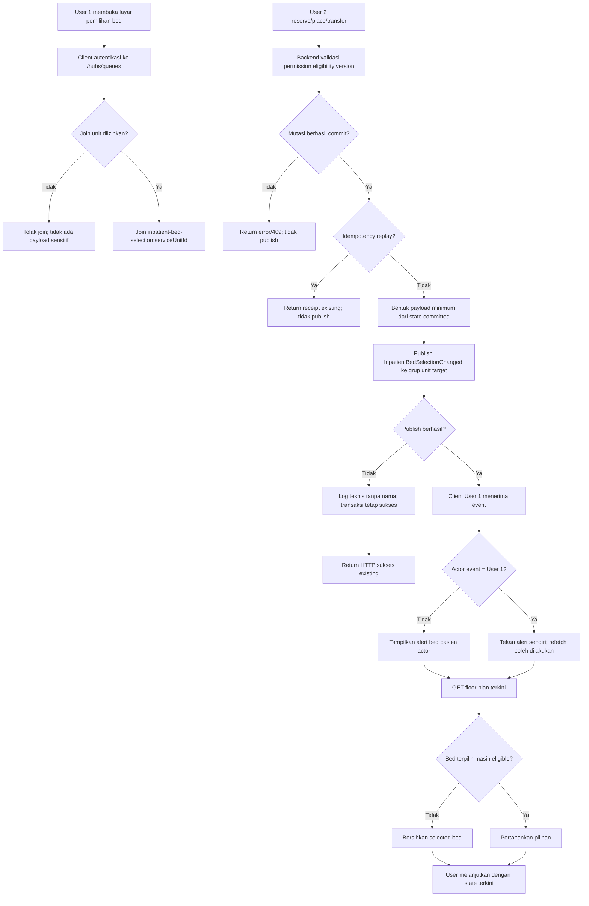
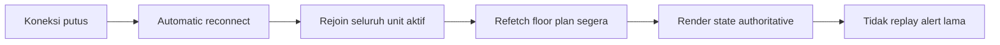

# FLOW-RI-MVP-021 — Notifikasi Realtime Pemilihan Bed

| Atribut | Nilai |
|---|---|
| Flow ID | `FLOW-RI-MVP-021` |
| Contract | `0.16.0` (`approved_design_planned`, `RWI-DEC-337`) |
| Trigger | Reservasi, penempatan, atau target transfer berhasil commit |
| Actor utama | Petugas yang melakukan mutasi dan petugas lain pada selection unit sama |
| Source of truth | State bed committed dan GET floor plan |

## Alur utama

## Reconnect dan recovery

## Failure path penting

| Kondisi | Hasil pengguna/sistem |
|---|---|
| User lain tidak berwenang pada unit | Tidak dapat join dan tidak menerima nama pasien |
| SignalR gagal setelah commit | Mutasi User 2 tetap sukses; User 1 akan pulih melalui refresh/reconnect |
| User 1 submit sebelum event selesai | Backend menentukan pemenang; yang kalah menerima `409` dan refresh |
| Refetch gagal | Alert tetap tampil, error loading existing tampil, payload tidak dipakai sebagai state |
| Popup kamar tertutup | Alert tetap diterima karena koneksi dimiliki selection screen |

## Output selesai

- Pengguna lain pada unit yang sama mengetahui bed telah dikuasai dan oleh siapa.
- Denah serta eligibility dimuat ulang dari server.
- Pilihan yang usang dibersihkan.
- Tidak ada PHI yang disebar lintas unit dan tidak ada transaksi yang bergantung pada delivery event.
