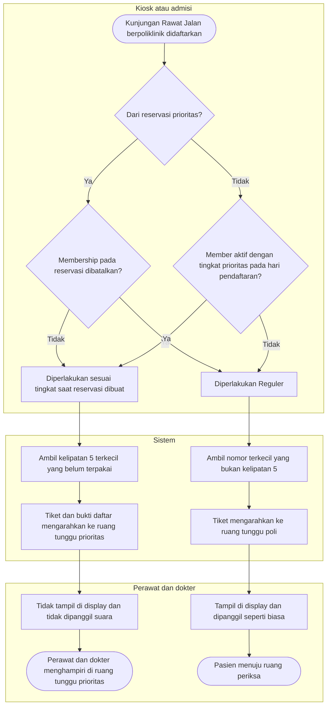

# Flowchart — Antrean Prioritas dan Layar Display (Amendment RP)

| Field | Nilai |
|---|---|
| Revisi blueprint | `33` (`approved` 2026-10-16) |
| Keputusan | `RJ-PRI-DEC-004` s.d. `007`, `017`, `018`, `024`, `025` |

Flowchart ini berlaku untuk semua pasien yang mendapat nomor antrean Rawat Jalan, baik lewat reservasi, kiosk, maupun
loket.

| Langkah | Pelaku | Masukan | Keluaran | Bila gagal |
|---|---|---|---|---|
| Tentukan klasifikasi | Sistem | Pasien, hari pendaftaran, atau snapshot reservasi | Prioritas atau Reguler | Status member tidak terbaca: pasien diperlakukan Reguler dan pendaftaran tetap jalan |
| Ambil nomor | Sistem | Klasifikasi, poli, tanggal | Nomor antrean | Dua pendaftaran bersamaan: kunci nomor membuat salah satunya menunggu, sehingga tidak ada nomor ganda |
| Cetak tiket / bukti | Kiosk, admisi | Klasifikasi, nama ruang tunggu prioritas | Arahan ruang tunggu | Nama ruang belum diatur: tiket memakai nama bawaan |
| Tampil di display | Sistem | Antrean Reguler saja | Display dan suara | Kabar realtime terputus: display memuat ulang daftar berkala |
| Menghampiri | Perawat, dokter | Penanda lokasi di worklist | Pasien dilayani | Pasien tidak ada di ruang prioritas: petugas menghubungi admisi |
