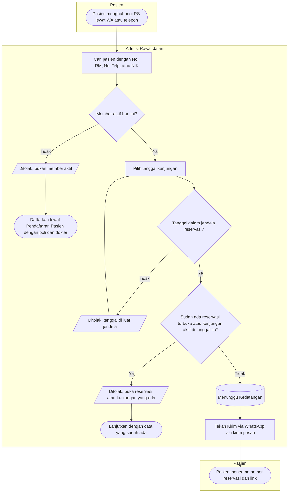
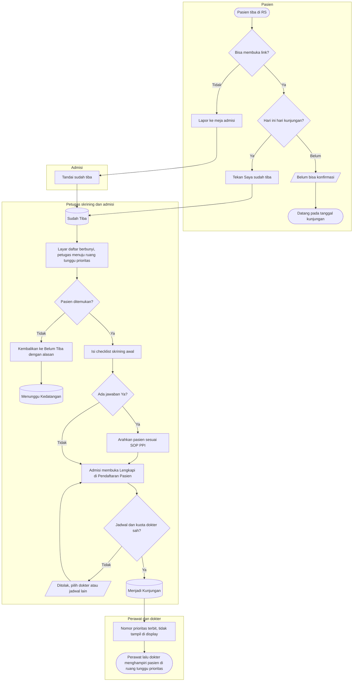
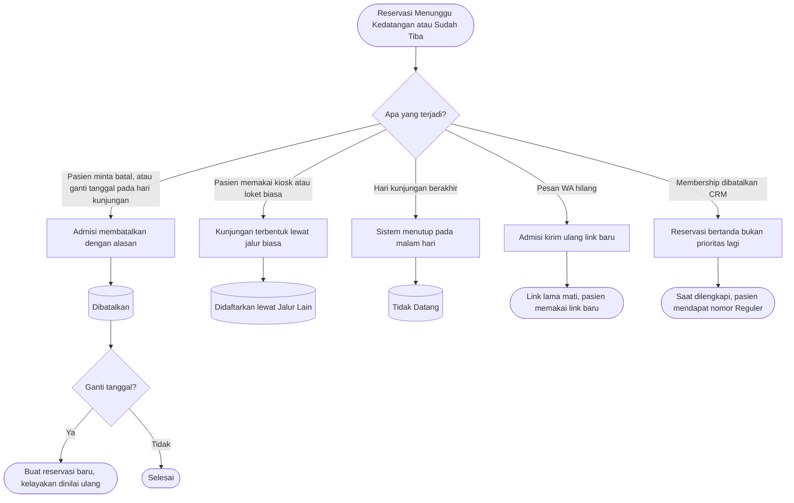
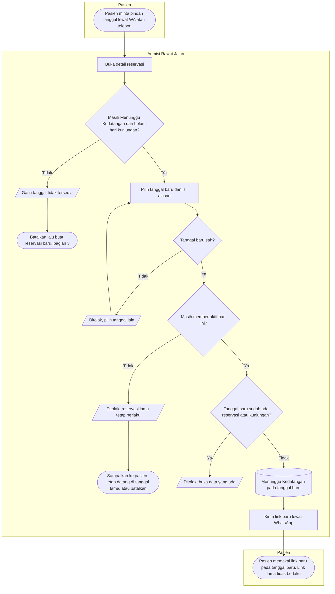

# Flowchart — Reservasi Pasien Prioritas (Amendment RP)

| Field | Nilai |
|---|---|
| Revisi blueprint | `33` (`approved` 2026-10-16) |
| Keputusan | `RJ-PRI-DEC-008` s.d. `029` ([00-interview-decisions.md](../00-interview-decisions.md), *Amendment RP*) |
| Status pada node | Sama persis dengan [state-transition-matrix.md](../contracts/state-transition-matrix.md) *Amendment RP* |

Flowchart ini menggambarkan langkah petugas dan pasien. Kalimat pesan penolakan ada di
[validation-matrix.md](../contracts/validation-matrix.md) *Amendment RP*, dan tidak disalin di sini.

## 1. Membuat reservasi dan mengirim link

| Langkah | Pelaku | Masukan | Keluaran | Bila gagal |
|---|---|---|---|---|
| Cari pasien | Admisi | No. RM, No. Telp, atau NIK | Pasien terpilih beserta label member | Pasien belum terdaftar: daftarkan pasien baru dulu (`CRM-DEC-003`) |
| Periksa kelayakan | Sistem | Pasien, hari ini (WIB) | Layak atau tidak | Bukan member Aktif: admisi mendaftarkan kunjungan biasa dengan poli dan dokter |
| Pilih tanggal | Admisi | Tanggal kunjungan | Tanggal sah | Di luar jendela: admisi memilih tanggal lain |
| Simpan | Admisi | Pasien, tanggal | Reservasi Menunggu Kedatangan, nomor, link | Ada reservasi terbuka atau kunjungan aktif: admisi membuka yang sudah ada |
| Kirim | Admisi | Teks pesan, No. HP pasien | Pesan WA terkirim dari akun RS | WA tidak terbuka: admisi menyalin link manual |

## 2. Kedatangan, skrining, dan pelengkapan

| Langkah | Pelaku | Masukan | Keluaran | Bila gagal |
|---|---|---|---|---|
| Konfirmasi lewat link | Pasien | Link dari WA | Reservasi Sudah Tiba | Belum hari H: pasien datang pada tanggalnya. Link tidak berlaku: pasien melapor ke admisi |
| Tandai tiba | Admisi | Reservasi Menunggu Kedatangan | Sudah Tiba, sumber "petugas" | Bukan hari kunjungan: admisi memeriksa tanggal reservasi |
| Menghampiri | Petugas skrining, admisi | Kabar di layar daftar | Pasien ditemukan | Tidak ditemukan: kembalikan ke Belum Tiba dengan alasan, dan link aktif lagi |
| Checklist skrining | Petugas skrining | Batuk, demam, risiko jatuh | Checklist tersimpan | Isian kurang: lengkapi ketiganya. Ada "Ya": ikuti SOP PPI |
| Lengkapi | Admisi | Poli, dokter, jadwal, penjamin, consent | Kunjungan dan nomor antrean | Jadwal atau kuota tidak sah: pilih dokter atau jadwal lain. Reservasi tetap Sudah Tiba |
| Menghampiri pasien | Perawat, dokter | Penanda lokasi di worklist | Pasien dilayani | Pasien pindah tempat: petugas menghubungi lewat admisi |

## 3. Jalur penutupan dan pengecualian

| Langkah | Pelaku | Masukan | Keluaran | Bila gagal |
|---|---|---|---|---|
| Batal | Admisi | Alasan 10–500 karakter | Dibatalkan, link mati | Alasan kurang: lengkapi alasan |
| Ganti tanggal pada hari kunjungan | Admisi | Tanggal baru | Reservasi lama Dibatalkan, reservasi baru | Pasien sudah bukan member Aktif: daftarkan kunjungan biasa. Sebelum hari kunjungan, pakai bagian 4 (revisi `34`) |
| Jalur lain | Sistem | Kunjungan RJ berpoliklinik pada tanggal yang sama | Didaftarkan lewat Jalur Lain | Penutupan gagal: kunjungan ikut batal, dan petugas mengulang |
| Penutupan malam | Sistem | Tanggal kunjungan sudah lewat | Tidak Datang | Server mati: putaran berikutnya mengejar |
| Kirim ulang | Admisi | Reservasi Menunggu Kedatangan | Link baru | Pasien sudah tiba: link tidak dibutuhkan |
| Bukan prioritas lagi | Sistem (dibaca) | Status membership snapshot | Tanda di daftar dan detail | Admisi menghubungi pasien |

## 4. Ganti tanggal sebelum hari kunjungan (revisi `34`, `approved` 2026-10-21)

Keputusan `RJ-PRI-DEC-034` s.d. `038`. Pada hari kunjungan, jalurnya tetap bagian 3 (batal lalu buat baru).

| Langkah | Pelaku | Masukan | Keluaran | Bila gagal |
|---|---|---|---|---|
| Buka detail | Admisi | Nomor reservasi atau nama pasien | Detail dengan tombol Ganti Tanggal | Tombol tidak tampil: sudah hari kunjungan atau status bukan Menunggu Kedatangan. Admisi memakai bagian 3 |
| Pilih tanggal dan alasan | Admisi | Tanggal baru, alasan 10–500 karakter | Permintaan ganti tanggal | Tanggal sama, lampau, atau terlalu jauh: pilih tanggal lain |
| Nilai ulang member | Sistem | Pasien, hari ini (WIB) | Member Aktif atau tidak | Bukan member Aktif: reservasi lama tetap berlaku. Pasien datang di tanggal lama, atau admisi membatalkan atas permintaan pasien |
| Periksa tanggal baru | Sistem | Pasien, tanggal baru | Tanggal kosong | Sudah ada reservasi atau kunjungan: admisi membuka data yang ada |
| Simpan | Sistem | — | Tanggal baru, snapshot baru, link baru, riwayat | Diubah petugas lain di saat yang sama: muat ulang lalu ulangi |
| Kirim | Admisi | Teks pesan versi ganti tanggal | Pesan WA terkirim | WA tidak terbuka: salin link manual |
