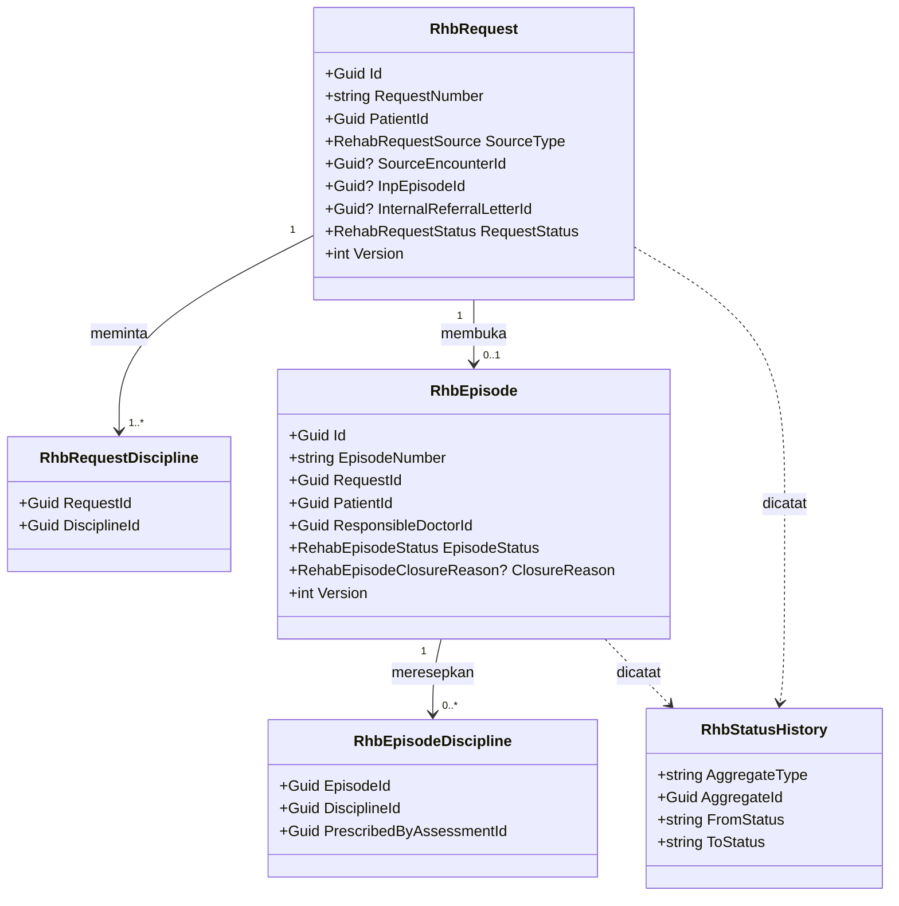
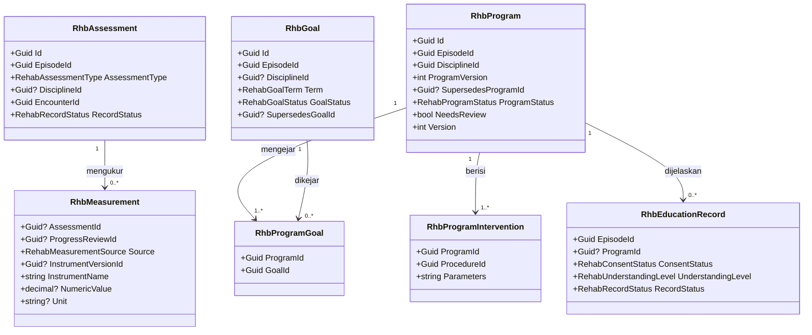
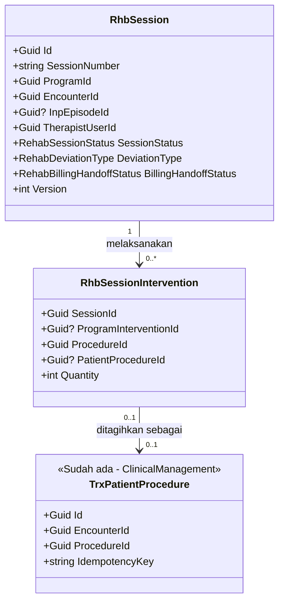
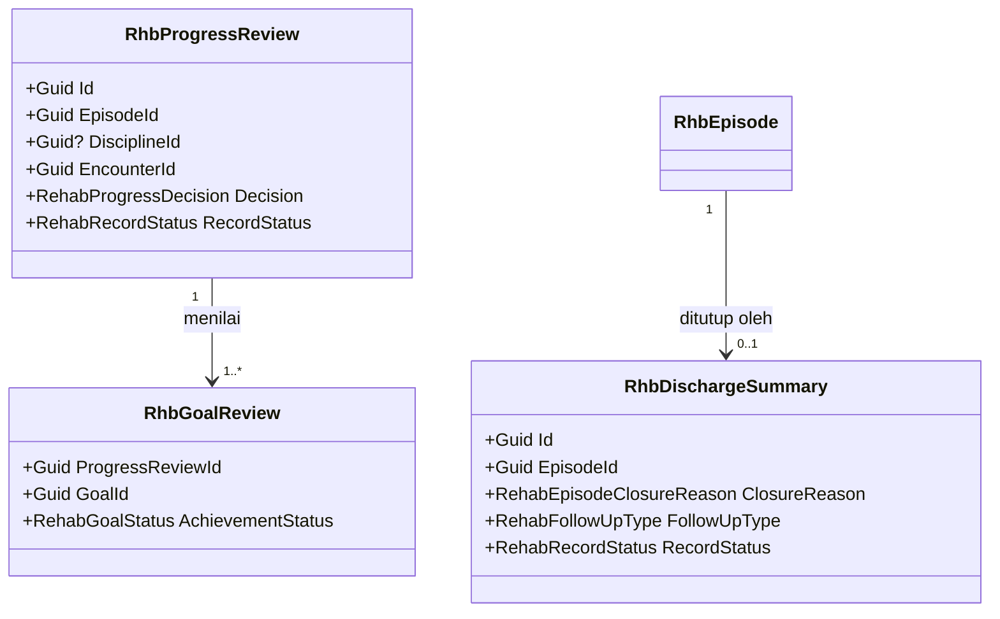
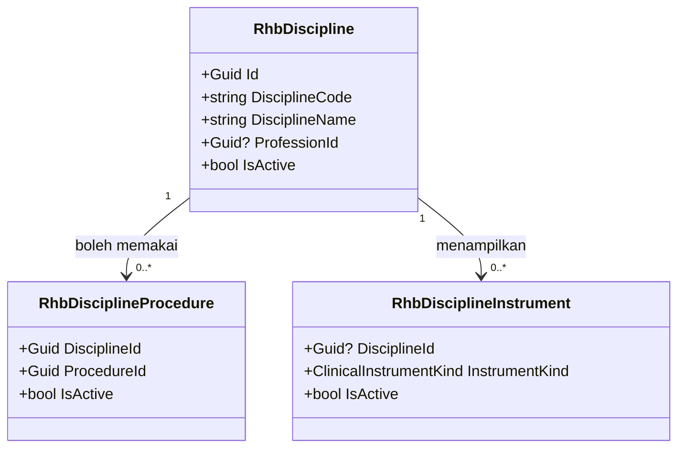
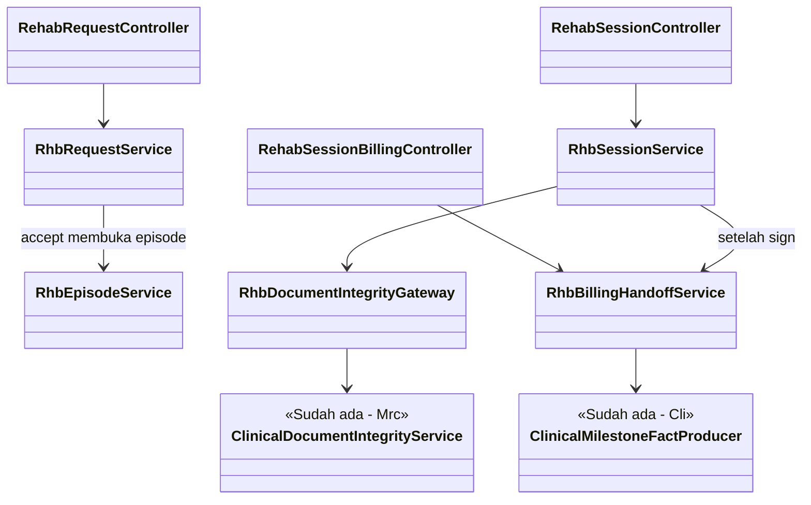

# Rehab Medik — Arsitektur Backend

| Field | Nilai |
|---|---|
| Blueprint ID | `RHB-BP-001` revision `1` |
| Status | `draft` — menunggu approval owner |
| Bentuk | `SINGLE` |
| Area / Module / Prefix | `HealthServices` / `RehabilitationManagement` / `Rhb` (registry `ACTIVE`, 2026-11-05) |
| Applicability | `NEW CODE` untuk seluruh `Rhb*`. `TOUCHED LEGACY` untuk 4 berkas milik modul lain (§7.2). |
| Backend SHA | `6bb3fba7` |
| Keputusan acuan | RHB-DEC-001..021, gate `02-requirement-completeness-assessment.md` |
| QBE yang berlaku | QBE-MOD-002/003, QBE-NAM-001/002/004, QBE-SVC-001, QBE-API-001, QBE-PERM-001, QBE-LOG-001, QBE-CODE-002/003 |

---

## 1. Bounded context dan ownership

Modul ini memiliki **satu bounded context**: *episode rehabilitasi*. Pusatnya adalah
`RhbEpisode`, dan seluruh dokumen klinis rehab menempel padanya.

| Aggregate root | Isi aggregate | Invariant utama | Batas transaksi |
|---|---|---|---|
| `RhbRequest` | `RhbRequestDiscipline` | Permintaan selalu tertaut ke pasien, dan ke encounter **atau** rujukan eksternal (RHB-INV-01). Penolakan klinis hanya lewat aksi disposisi (RHB-INV-02). | Satu permintaan per transaksi. Aksi `accept` membuka `RhbEpisode` **dalam transaksi yang sama**: keduanya tersimpan, atau tidak sama sekali. |
| `RhbEpisode` | `RhbEpisodeDiscipline`, `RhbGoal`, `RhbDischargeSummary` | Satu episode per permintaan yang diterima. Episode `Closed` tidak bisa dibuka lagi. Penutupan hanya lewat tanda tangan ringkasan akhir. | Perubahan status episode selalu bersama dokumen pemicunya |
| `RhbAssessment` | `RhbMeasurement` | Asesmen profesi hanya untuk disiplin yang sudah diresepkan. Penulis harus berprofesi sesuai disiplin (RHB-INV-08). | Satu dokumen |
| `RhbProgram` | `RhbProgramIntervention`, `RhbProgramGoal` | Program hanya aktif bila asesmen medis episode dan asesmen disiplinnya sudah final (RHB-INV-03). Satu versi aktif per disiplin per episode. Perubahan membuat versi baru. | Aktivasi versi baru dan penonaktifan versi lama dalam satu transaksi |
| `RhbSession` | `RhbSessionIntervention` | Sesi hanya merujuk program aktif dan encounter kunjungan yang terbuka (RHB-INV-04). `NotDone` tidak pernah tertagih (RHB-INV-06). | Tanda tangan sesi dan pembentukan `TrxPatientProcedure` dalam satu transaksi. Pemancaran fakta billing di luar transaksi itu, bisa diulang (pola HD). |
| `RhbProgressReview` | `RhbGoalReview`, `RhbMeasurement` | Keputusan `Stop` menghentikan program terkait. `Modify` menandai program perlu revisi. | Tanda tangan dan efek keputusan dalam satu transaksi |
| `RhbEducationRecord` | — | Status persetujuan `Refused` memblokir aktivasi program terkait (FEAT-015) | Satu dokumen |

**Penguncian dan addendum** tidak dibuat ulang. Setiap dokumen klinis rehab didaftarkan ke
`ClinicalDocumentIntegrityService` milik Rekam Medis (RHB-DEC-007, 019). Dokumen final tidak
bisa disunting, dan koreksi lewat addendum Rekam Medis.

**Concurrency:** setiap aggregate root punya kolom `Version` (`int`, `IsConcurrencyToken`,
pola `HmdEpisodeConfiguration`). Klien mengirim `expectedVersion`. Bila tidak sama, permintaan
ditolak dengan kode 409.

**Contoh concurrency.** Dua terapis membuka program fisioterapi versi 3 (`Version = 5`).
Terapis A menyimpan perubahan, sehingga `Version` menjadi 6. Terapis B lalu menyimpan dengan
`expectedVersion = 5`, dan ditolak dengan kode 409 "Data sudah diubah pengguna lain, muat
ulang". Perubahan B tidak menimpa A.

---

## 2. Tabel kepemilikan data

| Kelompok data | Modul pemilik | Dipakai modul ini | Dibuat ulang di modul ini |
|---|---|:---:|---|
| Pasien | PatientManagement (`MstPatient`) | Ya | Tidak — hanya `PatientId` |
| Kunjungan/encounter RJ, RWI, IGD | RegistrationManagement (`RegPatientEncounter`) | Ya | Tidak — dibaca lewat lookup rehab (RHB-DEC-016) |
| Episode rawat inap, status pulang | InPatientManagement (`InpEpisode`) | Ya | Tidak |
| Surat rujukan internal | ClinicalManagement (`CliDoctorCertificate`) | Ya (opsional sebagai sumber) | Tidak — hanya id rujukan |
| Poli dan tipe klinik | MasterData (`MstClinic`, `ClinicType.Rehabilitation`) | Ya | Tidak |
| Dokter (Sp.KFR) | HR Workforce (`MstDoctor`) | Ya | Tidak |
| Profesi terapis | HR Competency (`MstProfession`) | Ya | Tidak — dipetakan lewat `RhbDiscipline.ProfessionId` |
| Tindakan dan tarif | MasterData (`MstProcedure`, tarif) | Ya | Tidak — dipetakan lewat `RhbDisciplineProcedure` |
| Tindakan pasien bertarif | ClinicalManagement (`TrxPatientProcedure`, legacy) | Ya (ditulis, pola HD) | Tidak |
| Instrumen klinis berversi | ClinicalManagement (`CliClinicalInstrument*`) | Ya | Tidak |
| Keutuhan dokumen, addendum | MedicalRecordManagement (`MrcClinicalDocumentIntegrity`, `MrcClinicalNoteAddendum`) | Ya | Tidak |
| Penomoran | Platform NumberSeries (`Num`) | Ya | Tidak |
| Disiplin rehab dan pemetaannya | **Rehab** | Ya | **Ya, baru** — hanya bermakna di unit rehab (preseden `HmdSetting`, `OptSetting`) |
| Permintaan, episode, asesmen, tujuan, program, edukasi, sesi, reasesmen, ringkasan | **Rehab** | Ya | **Ya, baru** |
| CPPT | ClinicalManagement | Tidak di rilis 1 | Tidak (RHB-DEC-013) |

---

## 3. Class diagram

### 3.1 Permintaan dan episode



### 3.2 Asesmen, tujuan, program, dan edukasi



### 3.3 Sesi dan handoff billing



### 3.4 Evaluasi dan penutupan



### 3.5 Konfigurasi milik rehab



### 3.6 Lapisan service dan controller



---

## 4. Penjelasan setiap class

### 4.1 Model

| Class | Status | Lokasi file | Kategori | Tanggung jawab | Catatan desain |
|---|---|---|---|---|---|
| `RhbRequest` | Baru | `Areas/HealthServices/RehabilitationManagement/Models/RhbRequest.cs` | Transaksi | Satu permintaan layanan rehab untuk satu pasien beserta asal, indikasi, disiplin yang diminta, dan keputusan disposisinya | Nomor dari deret `RHB_REQUEST`. `IndicationText` sensitif. Tidak dihapus, hanya `cancel`. |
| `RhbRequestDiscipline` | Baru | `.../Models/RhbRequestDiscipline.cs` | Transaksi (anak) | Disiplin yang diminta pengirim | Unik `(RequestId, DisciplineId)` |
| `RhbEpisode` | Baru | `.../Models/RhbEpisode.cs` | Transaksi | Satu rangkaian layanan rehab sejak permintaan diterima sampai ditutup | Unik `RequestId`. `ResponsibleDoctorId` = Sp.KFR penanggung jawab. |
| `RhbEpisodeDiscipline` | Baru | `.../Models/RhbEpisodeDiscipline.cs` | Transaksi (anak) | Disiplin yang diresepkan Sp.KFR lewat asesmen medis final | Dibentuk saat asesmen medis ditandatangani. Unik `(EpisodeId, DisciplineId)`. |
| `RhbAssessment` | Baru | `.../Models/RhbAssessment.cs` | Dokumen klinis | Asesmen medis awal (Sp.KFR) atau asesmen awal profesi | `ClinicalDocumentKind.RehabAssessment = 47`. Satu asesmen medis awal final per episode. |
| `RhbMeasurement` | Baru | `.../Models/RhbMeasurement.cs` | Dokumen klinis (anak) | Satu hasil ukur, baik dari mesin instrumen (`InstrumentVersionId` + jawaban + skor) maupun terstruktur (nama, bagian tubuh/domain, nilai, satuan) | Tepat satu dari `AssessmentId` / `ProgressReviewId` terisi (check constraint) |
| `RhbGoal` | Baru | `.../Models/RhbGoal.cs` | Transaksi | Tujuan terukur: baseline, target, horizon, status | Tujuan yang sudah dirujuk program aktif tidak disunting. Perubahan dilakukan lewat `revise`, sehingga terbentuk baris baru dengan `SupersedesGoalId`. |
| `RhbProgram` | Baru | `.../Models/RhbProgram.cs` | Dokumen klinis | Program intervensi satu disiplin, berversi | `ClinicalDocumentKind.RehabProgram = 48`. Unik parsial: satu `Active` per `(EpisodeId, DisciplineId)`. |
| `RhbProgramIntervention` | Baru | `.../Models/RhbProgramIntervention.cs` | Dokumen klinis (anak) | Jenis intervensi (tindakan master), frekuensi/dosis/durasi sebagai teks isian, kewaspadaan | `ProcedureId` wajib ada di `RhbDisciplineProcedure` aktif untuk disiplin itu |
| `RhbProgramGoal` | Baru | `.../Models/RhbProgramGoal.cs` | Relasi | Tujuan yang dikejar program | Unik `(ProgramId, GoalId)` |
| `RhbEducationRecord` | Baru | `.../Models/RhbEducationRecord.cs` | Dokumen klinis | Edukasi rencana dan status persetujuan pasien/keluarga (FEAT-015) | `ClinicalDocumentKind.RehabEducation = 52` |
| `RhbSession` | Baru | `.../Models/RhbSession.cs` | Dokumen klinis | Satu sesi terapi: cek keselamatan, tindakan aktual, respons, deviasi, status handoff billing | `ClinicalDocumentKind.RehabSession = 49`. Nomor dari deret `RHB_SESSION`. |
| `RhbSessionIntervention` | Baru | `.../Models/RhbSessionIntervention.cs` | Dokumen klinis (anak) | Tindakan yang **benar-benar** diberikan, beserta parameter aktual, durasi, dan jumlah | `PatientProcedureId` terisi saat sesi ditandatangani |
| `RhbProgressReview` | Baru | `.../Models/RhbProgressReview.cs` | Dokumen klinis | Reasesmen dan keputusan lanjut/modifikasi/henti/rujuk/selesai | `ClinicalDocumentKind.RehabProgressReview = 50` |
| `RhbGoalReview` | Baru | `.../Models/RhbGoalReview.cs` | Dokumen klinis (anak) | Status capaian per tujuan pada satu reasesmen | Unik `(ProgressReviewId, GoalId)` |
| `RhbDischargeSummary` | Baru | `.../Models/RhbDischargeSummary.cs` | Dokumen klinis | Ringkasan akhir dan tindak lanjut | `ClinicalDocumentKind.RehabDischargeSummary = 51`. Unik `EpisodeId`. |
| `RhbStatusHistory` | Baru | `.../Models/RhbStatusHistory.cs` | Audit | Riwayat perpindahan status permintaan, episode, program, dan sesi | Tidak pernah diubah atau dihapus |
| `RhbDiscipline` | Baru | `.../Models/RhbDiscipline.cs` | Konfigurasi | Disiplin terapi yang dilayani beserta profesinya | Data awal di §8. Tidak di sub-folder `MasterData` (catatan registry). |
| `RhbDisciplineProcedure` | Baru | `.../Models/RhbDisciplineProcedure.cs` | Konfigurasi | Tindakan master yang boleh dipakai disiplin | Unik `(DisciplineId, ProcedureId)` |
| `RhbDisciplineInstrument` | Baru | `.../Models/RhbDisciplineInstrument.cs` | Konfigurasi | Jenis instrumen yang ditawarkan pada asesmen disiplin. `DisciplineId = null` berarti asesmen medis. | Unik `(DisciplineId, InstrumentKind)`. Tidak memakai `SortOrder` tersimpan. |

### 4.2 Service

Seluruh service tanpa interface, didaftarkan `AddScoped<T>()` di `Program.cs`, kecuali
`RhbMedicalRecordDocumentSource` yang mengimplementasikan `IMedicalRecordDocumentSource`.
Lokasi: `Areas/HealthServices/RehabilitationManagement/Services/`.

| Service | Status | Fungsi utama | Dipanggil oleh | Transaksi DB |
|---|---|---|---|---|
| `RhbRequestService` | Baru | Buat/ubah draft, submit (validasi + cek duplikasi), kembalikan, disposisi (terima/alihkan/tolak/klarifikasi), batal, riwayat | `RehabRequestController` | Ya. `accept` membuka episode di transaksi yang sama. |
| `RhbLookupService` | Baru | Pilihan pasien, kunjungan terbuka milik pasien, surat rujukan internal, dokter, disiplin aktif, tindakan per disiplin, instrumen per disiplin | `RehabLookupController` | Tidak (baca) |
| `RhbEpisodeService` | Baru | Worklist, detail, timeline, perpindahan status internal | Controller episode, service lain | Ya (internal) |
| `RhbAssessmentService` | Baru | Asesmen medis dan profesi: draft, ubah, tanda tangan, batal draft. Saat asesmen medis ditandatangani, terbentuk `RhbEpisodeDiscipline` dan episode berpindah ke `Planning`. | Dua controller asesmen | Ya |
| `RhbGoalService` | Baru | Buat, ubah, revisi, hentikan tujuan | `RehabGoalController` | Ya |
| `RhbProgramService` | Baru | Draft, ubah, revisi (versi baru), aktivasi (tanda tangan + nonaktifkan versi lama + episode `Active`), henti, batal draft | `RehabProgramController`, `RhbProgressReviewService` | Ya |
| `RhbEducationService` | Baru | Catat edukasi/persetujuan, tanda tangan | `RehabEducationController` | Ya |
| `RhbSessionService` | Baru | Mulai (cek keselamatan + encounter), ubah isi, selesai, henti dini, tidak terlaksana, tanda tangan, batal draft, worklist | `RehabSessionController` | Ya. Tanda tangan juga membentuk `TrxPatientProcedure`. |
| `RhbBillingHandoffService` | Baru | Memancarkan fakta charge per intervensi, status, dan ulang | `RhbSessionService`, `RehabSessionBillingController` | Ya (status handoff) |
| `RhbProgressReviewService` | Baru | Reasesmen, tanda tangan, efek keputusan | `RehabProgressReviewController` | Ya |
| `RhbDischargeService` | Baru | Ringkasan akhir (upsert draft), tanda tangan → episode `Closed`, program aktif → `Completed` | `RehabDischargeSummaryController` | Ya |
| `RhbConfigurationService` | Baru | CRUD disiplin beserta pemetaan tindakan dan instrumen | `RehabDisciplineController` | Ya |
| `RhbDocumentIntegrityGateway` | Baru | Pembungkus tipis `ClinicalDocumentIntegrityService`: `RegisterAsync` saat draft, `EnsureMutableAsync` sebelum ubah, `SignAsync` saat tanda tangan | Service dokumen klinis rehab | Tidak menyimpan sendiri (ikut pemanggil) |
| `RhbProfessionAuthority` | Baru | Menentukan `MstProfession` pengguna (karyawan atau pengguna eksternal, pola `InpatientClinicalContextService`) dan mencocokkannya dengan `RhbDiscipline.ProfessionId` | Service asesmen/program/sesi | Tidak |
| `RhbServiceSupport` | Baru | Pemeriksaan encounter (pola `HmdServiceSupport.CheckEncounterAsync`), advisory lock, pembantu nomor | Service rehab | Tidak |
| `RhbMedicalRecordDocumentSource` | Baru | Pembaca dokumen final rehab untuk berkas RM. Wajib `null` untuk pasien lain. | Rekam Medis (`IEnumerable<IMedicalRecordDocumentSource>`) | Tidak (baca) |

### 4.3 Controller

Lokasi: `Areas/HealthServices/RehabilitationManagement/Controllers/`. Satu Resource hak akses
satu controller, mengikuti `HemodialysisPermissions`. Seluruh atribut memakai konstanta
`RehabilitationPermissions`.

| Controller | Status | Base route (`api/v1/health-services/rehabilitation-management/…`) | Resource | Service |
|---|---|---|---|---|
| `RehabRequestController` | Baru | `rehab-requests` | `RehabRequest` | `RhbRequestService` |
| `RehabLookupController` | Baru | `rehab-lookups` | `RehabLookup` | `RhbLookupService` |
| `RehabEpisodeController` | Baru | `rehab-episodes` | `RehabEpisode` | `RhbEpisodeService` |
| `RehabMedicalAssessmentController` | Baru | `rehab-medical-assessments` | `RehabMedicalAssessment` | `RhbAssessmentService` |
| `RehabDisciplineAssessmentController` | Baru | `rehab-discipline-assessments` | `RehabDisciplineAssessment` | `RhbAssessmentService` |
| `RehabGoalController` | Baru | `rehab-goals` | `RehabGoal` | `RhbGoalService` |
| `RehabProgramController` | Baru | `rehab-programs` | `RehabProgram` | `RhbProgramService` |
| `RehabEducationController` | Baru | `rehab-education-records` | `RehabEducation` | `RhbEducationService` |
| `RehabSessionController` | Baru | `rehab-sessions` | `RehabSession` | `RhbSessionService` |
| `RehabSessionBillingController` | Baru | `rehab-sessions` (`/{id}/billing-handoff`) | `RehabBillingHandoff` | `RhbBillingHandoffService` |
| `RehabProgressReviewController` | Baru | `rehab-progress-reviews` | `RehabProgressReview` | `RhbProgressReviewService` |
| `RehabDischargeSummaryController` | Baru | `rehab-discharge-summaries` | `RehabDischargeSummary` | `RhbDischargeService` |
| `RehabDisciplineController` | Baru | `rehab-disciplines` | `RehabConfiguration` | `RhbConfigurationService` |

Tidak ada controller yang mengakses `ApplicationDbContext` langsung (QBE-SVC-001).

---

## 5. Arsitektur folder

```text
Areas/HealthServices/RehabilitationManagement/          [Baru]
├── Constants/
│   ├── RehabilitationPermissions.cs                    [Baru] resource/action, ModuleCode
│   ├── RhbNumberSeries.cs                              [Baru] RHB_REQUEST, RHB_EPISODE, RHB_SESSION
│   └── RhbErrorCodes.cs                                [Baru] kode penolakan RHB-VAL-xxx
├── Controllers/                                        [Baru] 13 controller (§4.3)
├── DTOs/
│   ├── RehabRequestDtos.cs  RehabLookupDtos.cs  RehabEpisodeDtos.cs
│   ├── RehabAssessmentDtos.cs  RehabGoalDtos.cs  RehabProgramDtos.cs
│   ├── RehabEducationDtos.cs  RehabSessionDtos.cs  RehabBillingHandoffDtos.cs
│   └── RehabProgressReviewDtos.cs  RehabDischargeDtos.cs  RehabDisciplineDtos.cs   [Baru]
├── Enums/                                              [Baru] 18 enum (data dictionary §3)
├── Models/                                             [Baru] 20 model (§4.1)
└── Services/                                           [Baru] 16 service (§4.2)

Repositories/Configurations/HealthServices/RehabilitationManagement/   [Baru] 20 configuration
Repositories/ApplicationDbContext.cs                    [Diperbarui] +20 DbSet
Program.cs                                              [Diperbarui] DI 16 service + 1 IMedicalRecordDocumentSource
Migrations/<timestamp>_AddRehabilitationManagement.cs   [Baru] (RHB-DEC-015)

Areas/HealthServices/MedicalRecordManagement/
├── Enums/ClinicalDocumentKind.cs                       [Diperbarui] +6 nilai (47–52)  — izin RM (DEC-019)
└── Services/ClinicalDocumentIntegrityService.cs        [Diperbarui] JenisYangDitegakkan +6 — izin RM
Areas/HealthServices/ClinicalManagement/
├── Enums/ClinicalInstrumentKind.cs                     [Diperbarui] +6 nilai (8–13)  — izin Cli (DEC-018)
└── Enums/PatientProcedureSource.cs                     [Diperbarui] +1 nilai RehabilitationSession = 5 — OQ-015
```

Tidak ada sub-folder `MasterData` di bawah `RehabilitationManagement`, karena akan berbenturan
dengan alias registry `Mst`. Konfigurasi rehab tinggal di `Models/`.

---

## 6. Status model dan dampak migration

| Model | Status | Dampak migration |
|---|---|---|
| 20 model `Rhb*` | Baru | 20 tabel baru (`public."Rhb…"`) |
| `ClinicalDocumentKind` | Diperbarui (enum) | Tidak ada perubahan schema. Kolom `DocumentKind` sudah `int`. |
| `ClinicalInstrumentKind` | Diperbarui (enum) | Tidak ada perubahan schema |
| `PatientProcedureSource` | Diperbarui (enum) | Tidak ada perubahan schema |
| `TrxPatientProcedure`, `MrcClinicalDocumentIntegrity`, `CliClinicalInstrument*`, `RegPatientEncounter`, `InpEpisode`, `MstProcedure`, `MstProfession`, `MstDoctor`, `MstPatient` | Sudah ada | Tidak berubah |

## 7. Rencana migration

| Urutan | Migration | Isi | Tanpa downtime? | Data lama | Mundur |
|---|---|---|---|---|---|
| 1 | `AddRehabilitationManagement` | 20 tabel, FK `Restrict` ke tabel milik modul lain, index, unique, check constraint | Ya. Hanya `CREATE TABLE`, tidak menyentuh tabel lama. | Tidak ada | `Down()` men-drop ke-20 tabel. Aman karena belum ada data. |

Sesuai RHB-DEC-015, file migration ditulis agent tetapi **dihasilkan ulang/diverifikasi dan
dijalankan oleh owner**. Owner menjalankan `dotnet ef migrations has-pending-model-changes`
sesudahnya, dan hasilnya harus "tidak ada perubahan tertunda".

### 7.2 Berkas milik modul lain yang disentuh (TOUCHED LEGACY)

| Berkas | Perubahan | Izin |
|---|---|---|
| `MedicalRecordManagement/Enums/ClinicalDocumentKind.cs` | `RehabAssessment = 47`, `RehabProgram = 48`, `RehabSession = 49`, `RehabProgressReview = 50`, `RehabDischargeSummary = 51`, `RehabEducation = 52` | RHB-DEC-019 (bukti OQ-012) |
| `MedicalRecordManagement/Services/ClinicalDocumentIntegrityService.cs` | Keenam nilai masuk `JenisYangDitegakkan` | RHB-DEC-019 |
| `ClinicalManagement/Enums/ClinicalInstrumentKind.cs` | `RehabBarthelIndex = 8`, `RehabBergBalanceScale = 9`, `RehabTimedUpAndGo = 10`, `RehabLawtonIadl = 11`, `RehabGussSwallowing = 12`, `RehabFoisOralIntake = 13`. NRS/VAS memakai `PainScale = 3` yang sudah ada. | RHB-DEC-018 |
| `ClinicalManagement/Enums/PatientProcedureSource.cs` | `RehabilitationSession = 5` | RHB-OQ-015 |

---

## 8. Rencana data master awal

| Master | Isi minimum | Sumber nilai |
|---|---|---|
| `RhbDiscipline` | `PHYSIOTHERAPY` Fisioterapi, `OCCUPATIONAL_THERAPY` Terapi Okupasi, `SPEECH_THERAPY` Terapi Wicara (aktif). `ORTHOTIC_PROSTHETIC` Ortotik-Prostetik (**tidak aktif**, RHB-DEC-004). `ProfessionId` diisi admin. | RHB-DEC-004. Kode bersifat tetap. Seeder idempoten milik modul rehab hanya untuk tabel rehab sendiri. |
| `RhbDisciplineProcedure` | Diisi admin dari `MstProcedure` tindakan rehab yang sudah ada | RHB-OQ-016. Tanpa baris ini program tidak bisa disusun, dan layar menampilkannya sebagai prasyarat. |
| `RhbDisciplineInstrument` | Medis: `PainScale`, `RehabBarthelIndex`. Fisioterapi: `PainScale`, `RehabBergBalanceScale`, `RehabTimedUpAndGo`. Okupasi: `RehabBarthelIndex`, `RehabLawtonIadl`. Wicara: `RehabGussSwallowing`, `RehabFoisOralIntake`. | RHB-DEC-017. Definisi instrumennya dimasukkan komite lewat layar instrumen klinis dan baru berlaku setelah disahkan. |
| `MstClinic` (poli rehab), `MstProfession` OT/TW, `MstProcedure` tindakan rehab | **Bukan** milik rehab. Diinput admin (RHB-DEC-020). | Checklist go-live |
| Deret nomor | `RHB_REQUEST` → `RHB-REQ-2026-000001`, `RHB_EPISODE` → `RHB-EPS-2026-000001`, `RHB_SESSION` → `RHB-SES-2026-000001`, cakupan `YEARLY` | Pola `HMD_SESSION` |

## 9. Yang sengaja tidak dibuat

| Yang ditolak | Alasan |
|---|---|
| `RhbPatient`, `RhbEncounter`, `RhbPractitioner` | Sudah dimiliki PatientManagement, Registration, dan HR |
| Kunci/tanda tangan/addendum milik rehab | Sudah ada di Rekam Medis (RHB-DEC-007) |
| Mesin instrumen/skor milik rehab | Sudah ada di ClinicalManagement (RHB-DEC-006, 017) |
| Tabel tarif rehab | Tarif milik master tindakan dan Billing |
| `RhbSchedule`, antrean, slot | Phase 2 (FEAT-004..006, UNR-005) |
| `RhbDevice*` ortotik-prostetik | Phase 2 (RHB-DEC-004) |
| `RhbIntegrationOutbox` SATUSEHAT | Phase 3 (UNR-008) |
| Penulisan CPPT otomatis dari sesi | RHB-DEC-013, slice terpisah (OQ-014) |
| Endpoint `DELETE` pada transaksi | Transaksi dibatalkan lewat `cancel` (standar transaksi) |
| Status `UnderReview` pada permintaan | Tidak menambah makna: permintaan `Submitted` sudah berarti menunggu telaah, dan tidak ada aksi "mulai telaah" yang diminta. Delta terhadap usulan §5 decision log. |
