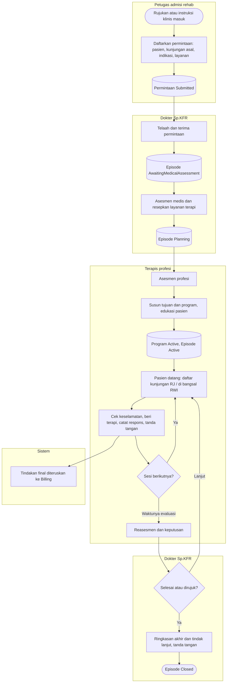

# Rehab Medik — Alur Utama (jalur normal)

Blueprint `RHB-BP-001` r1, `draft`. Jalur pengecualian ada di file proses masing-masing.
Nama status sama dengan `contracts/state-transition-matrix.md`.

| Langkah | Pelaku | Masukan | Keluaran | Bila gagal |
|---|---|---|---|---|
| Daftarkan permintaan | Admisi | Pasien, kunjungan asal / rujukan luar, indikasi, layanan | Permintaan `Submitted` | Lengkapi isian. Bila ada duplikasi, isi alasan atau batalkan. Lihat `permintaan-dan-disposisi.md`. |
| Telaah dan terima | Sp.KFR | Permintaan | Episode `AwaitingMedicalAssessment` | Kembalikan untuk klarifikasi, alihkan, atau tolak dengan alasan |
| Asesmen medis | Sp.KFR | Riwayat, pemeriksaan, instrumen | Episode `Planning`, layanan diresepkan | Simpan sebagai draft bila data belum cukup |
| Asesmen profesi | Terapis | Resep layanan | Asesmen final | Draft. Bila kontraindikasi, kembalikan ke Sp.KFR. |
| Tujuan, program, edukasi | Terapis | Asesmen | Program `Active` | Prasyarat yang kurang disebut layar. Bila pasien menolak, program tidak aktif. |
| Sesi terapi | Terapis | Kunjungan hari itu | Sesi final, tagihan | Lihat `sesi-terapi.md` |
| Reasesmen | Terapis / Sp.KFR | Baseline + hasil kini | Keputusan | Evaluasi tertunda dengan alasan |
| Ringkasan akhir | Sp.KFR | Seluruh catatan final | Episode `Closed` | Selesaikan atau batalkan catatan draft dulu. Lihat `penutupan-episode.md`. |
