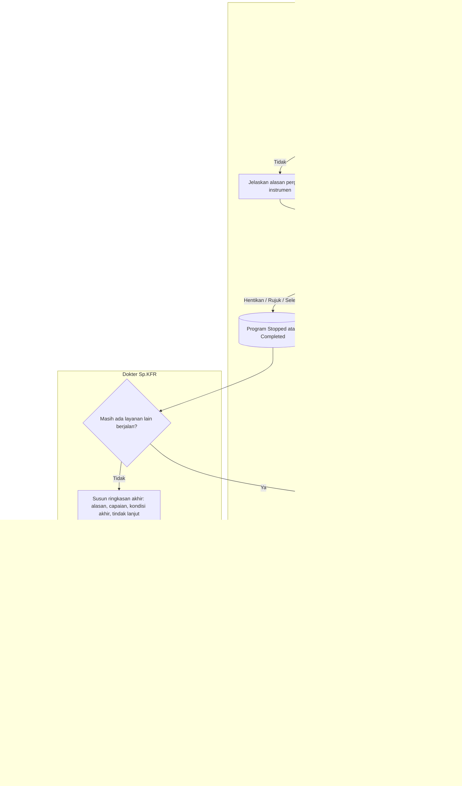

# Proses — Reasesmen dan Penutupan Episode (FEAT-024..027)

| Langkah | Pelaku | Masukan | Keluaran | Bila gagal |
|---|---|---|---|---|
| Ukur ulang | Terapis/Sp.KFR | Baseline | Pengukuran kini | Instrumen berbeda: isi alasan pergantian |
| Keputusan | Terapis/Sp.KFR | Capaian | Lanjut/Modifikasi/Henti/Rujuk/Selesai | Data belum lengkap: simpan draft |
| Ringkasan akhir | Sp.KFR | Semua catatan final | Episode `Closed` | Ada catatan draft: penulisnya menyelesaikan atau membatalkan |
| Putus layanan | Sp.KFR | Riwayat tidak hadir | Ditutup dengan alasan "putus layanan", **bukan** "selesai klinis" | — |
