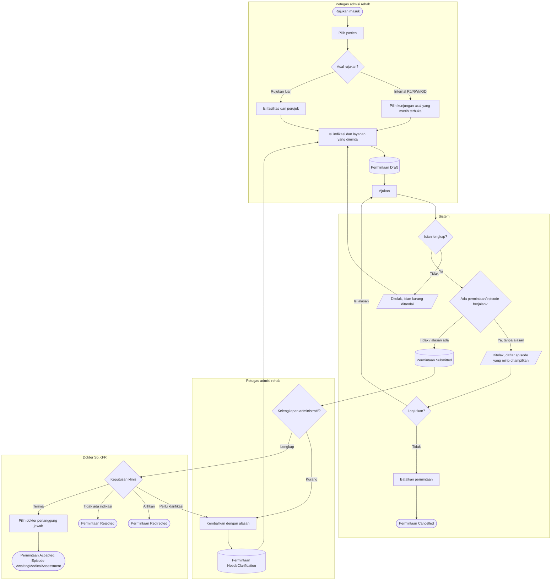

# Proses — Permintaan dan Disposisi (FEAT-001..003)

| Langkah | Pelaku | Masukan | Keluaran | Bila gagal |
|---|---|---|---|---|
| Pilih kunjungan asal | Admisi | Pasien | Kunjungan terbuka milik pasien | Kunjungan tidak muncul: minta pendaftaran memeriksa status kunjungan |
| Ajukan | Admisi | Draft | `Submitted` | Isian kurang → lengkapi. Duplikasi → isi alasan atau batalkan. |
| Kembalikan | Admisi | Alasan administratif | `NeedsClarification` | — |
| Keputusan klinis | Sp.KFR | Permintaan | `Accepted` / `Redirected` / `Rejected` / `NeedsClarification` | Admisi tidak bisa menolak secara klinis (tombol tidak muncul, dan server menolak) |
| Terima | Sp.KFR | Dokter penanggung jawab | Episode baru | Bila dokter tidak aktif, pilih dokter lain |
