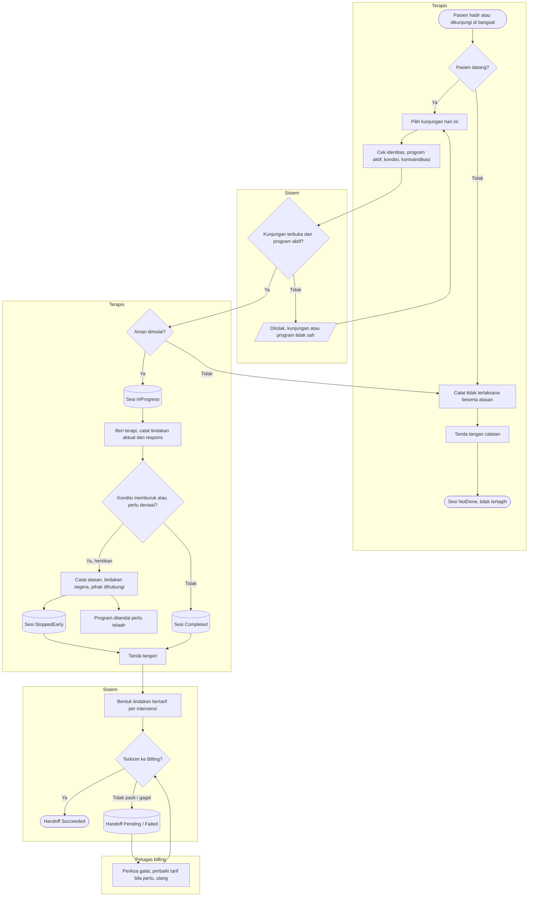

# Proses — Sesi Terapi dan Handoff Billing (FEAT-016..018, FEAT-032)

| Langkah | Pelaku | Masukan | Keluaran | Bila gagal |
|---|---|---|---|---|
| Catat tidak terlaksana | Terapis | Alasan (tidak hadir, batal, ditunda, menolak, kondisi klinis, sumber daya) | Sesi `NotDone` final | — |
| Cek keselamatan | Terapis | Identitas, program, kondisi | Boleh mulai / tidak | Kontraindikasi dicatat. Sesi tidak dimulai, atau dicatat tidak terlaksana. |
| Mulai | Sistem | Kunjungan + program | `InProgress` | Kunjungan sudah ditutup atau pasien RWI sudah pulang: daftarkan kunjungan hari ini |
| Henti dini | Terapis | Alasan, tindakan segera | `StoppedEarly`, program perlu telaah | — |
| Tanda tangan | Terapis | Respons terisi | Catatan final, tindakan bertarif | Respons kosong: lengkapi |
| Handoff | Sistem / billing | Tindakan bertarif | `Succeeded` | `Failed`: billing memeriksa tarif lalu menekan Ulang. Tidak tertagih dua kali. |
