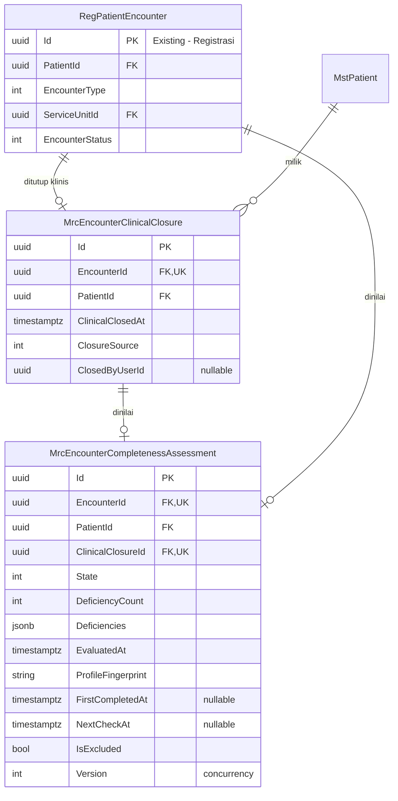
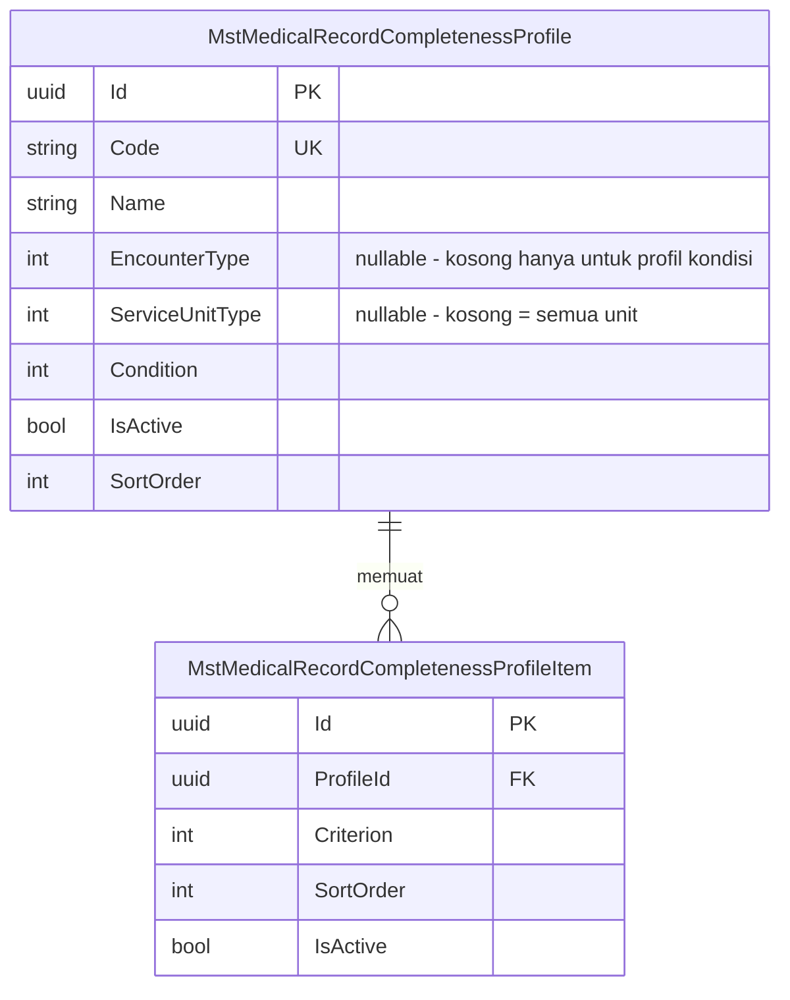
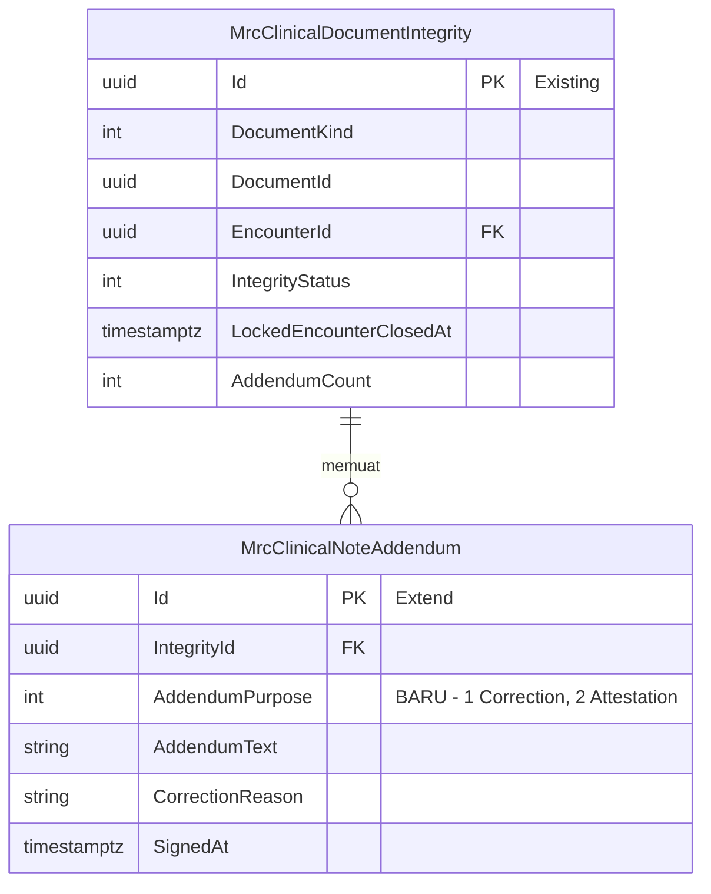

# ERD — Kelengkapan Berkas dan Penutupan Klinis

| Field | Value |
|---|---|
| Blueprint | `RM-BP-001` revision `4` — **`approved`**, Yoga Aji Pratama, 28 Oktober 2026 (`RM-DEC-062`) |
| Bounded context | `BC-RM-03` Kelengkapan Berkas; `BC-RM-02` Keutuhan Dokumen (penutupan klinis, jenis addendum) |
| Arsitektur domain | `RM-DA-001` revision 1 — `AGG-RM-02`, `AGG-RM-03`, `AGG-RM-04`, `DC-RM-09` |
| Keputusan | `RM-DEC-045`–`047`, `049`–`051`, `053`–`056`, `060`, `061` |
| Source SHA | Backend `363de34f` |

Kolom audit warisan `IdentityModel` tidak digambar. Seluruh entity di sini **Baru**, kecuali yang
diberi tanda lain.

## 1. Penutupan klinis dan penilaian



## 2. Profil dokumen wajib



`ServiceUnitType` adalah **nilai enum**, bukan FK ke `MstServiceUnit`: aturan berlaku untuk jenis
unit, bukan untuk satu unit tertentu (`RM-DEC-060`).

## 3. Jenis addendum (Diperbarui)



## 4. Status entity

| Entity | Status | Pemilik | Catatan |
|---|---|---|---|
| `MrcEncounterClinicalClosure` | **New** | Rekam Medis | Insert-only, satu per kunjungan |
| `MrcEncounterCompletenessAssessment` | **New** | Rekam Medis | Hasil turunan; diperbarui setiap penilaian ulang |
| `MstMedicalRecordCompletenessProfile` | **New** | Rekam Medis (master) | — |
| `MstMedicalRecordCompletenessProfileItem` | **New** | Rekam Medis (master) | — |
| `MrcClinicalNoteAddendum` | **Extend** | Rekam Medis | Satu kolom baru |
| `RegPatientEncounter`, `MstPatient`, `MrcClinicalDocumentIntegrity` | **Existing** | Registrasi, Patient Management, Rekam Medis | Hanya dirujuk |
| Seluruh dokumen sumber modul lain | **Adapter/View** | Modul masing-masing | **Tidak** digambar sebagai entity rekam medis — dibaca lewat `IMedicalRecordDocumentSource` |

## 5. Kunci, index, dan perilaku hapus

| Tabel | Index / unique | `DeleteBehavior` |
|---|---|---|
| `MrcEncounterClinicalClosure` | UK `EncounterId`; index `PatientId` | FK kunjungan dan pasien: `Restrict` |
| `MrcEncounterCompletenessAssessment` | UK `EncounterId`; UK `ClinicalClosureId`; index `(State, NextCheckAt)` untuk pemeriksaan berkala; index `(State, EvaluatedAt)` untuk daftar kerja | `Restrict` |
| `MstMedicalRecordCompletenessProfile` | UK `Code` WHERE `IsDelete = false`; UK `(EncounterType, ServiceUnitType, Condition)` WHERE `IsDelete = false` — kolom nullable dibandingkan dengan `NULLS NOT DISTINCT` | — |
| `MstMedicalRecordCompletenessProfileItem` | UK `(ProfileId, Criterion)` WHERE `IsDelete = false` | FK profil: `Restrict` |
| `MrcClinicalNoteAddendum` | **Baru:** UK `IntegrityId` WHERE `AddendumPurpose = 2 AND IsDelete = false` | Tidak berubah |

## 6. Skema DDL

> **Bagian ini dokumentasi bentuk, bukan skrip yang dijalankan.** Sumber kebenaran skema adalah
> configuration EF Core dan migration yang dibuat implementer. Kolom `IdentityModel` tidak ditulis.

```sql
CREATE TABLE public."MrcEncounterClinicalClosure" (
    "Id"               uuid        PRIMARY KEY,
    "EncounterId"      uuid        NOT NULL REFERENCES public."RegPatientEncounter"("Id") ON DELETE RESTRICT,
    "PatientId"        uuid        NOT NULL REFERENCES public."MstPatient"("Id") ON DELETE RESTRICT,
    "ClinicalClosedAt" timestamptz NOT NULL,
    "ClosureSource"    integer     NOT NULL,
    "ClosedByUserId"   uuid        NULL
);
CREATE UNIQUE INDEX ON public."MrcEncounterClinicalClosure" ("EncounterId");

CREATE TABLE public."MrcEncounterCompletenessAssessment" (
    "Id"                 uuid        PRIMARY KEY,
    "EncounterId"        uuid        NOT NULL REFERENCES public."RegPatientEncounter"("Id") ON DELETE RESTRICT,
    "PatientId"          uuid        NOT NULL REFERENCES public."MstPatient"("Id") ON DELETE RESTRICT,
    "ClinicalClosureId"  uuid        NOT NULL REFERENCES public."MrcEncounterClinicalClosure"("Id") ON DELETE RESTRICT,
    "State"              integer     NOT NULL,
    "DeficiencyCount"    integer     NOT NULL DEFAULT 0,
    "Deficiencies"       jsonb       NOT NULL DEFAULT '[]',
    "EvaluatedAt"        timestamptz NOT NULL,
    "ProfileFingerprint" varchar(64) NOT NULL,
    "FirstCompletedAt"   timestamptz NULL,
    "NextCheckAt"        timestamptz NULL,
    "IsExcluded"         boolean     NOT NULL DEFAULT false,
    "Version"            integer     NOT NULL DEFAULT 0
);

CREATE TABLE public."MstMedicalRecordCompletenessProfile" (
    "Id"              uuid         PRIMARY KEY,
    "Code"            varchar(30)  NOT NULL,
    "Name"            varchar(150) NOT NULL,
    "EncounterType"   integer      NULL,
    "ServiceUnitType" integer      NULL,
    "Condition"       integer      NOT NULL DEFAULT 0,
    "IsActive"        boolean      NOT NULL DEFAULT true,
    "SortOrder"       integer      NOT NULL DEFAULT 0,
    CHECK ("Condition" <> 0 OR "EncounterType" IS NOT NULL)
);

CREATE TABLE public."MstMedicalRecordCompletenessProfileItem" (
    "Id"        uuid    PRIMARY KEY,
    "ProfileId" uuid    NOT NULL REFERENCES public."MstMedicalRecordCompletenessProfile"("Id") ON DELETE RESTRICT,
    "Criterion" integer NOT NULL,
    "SortOrder" integer NOT NULL DEFAULT 0,
    "IsActive"  boolean NOT NULL DEFAULT true
);

ALTER TABLE public."MrcClinicalNoteAddendum"
    ADD COLUMN "AddendumPurpose" integer NOT NULL DEFAULT 1;
```
